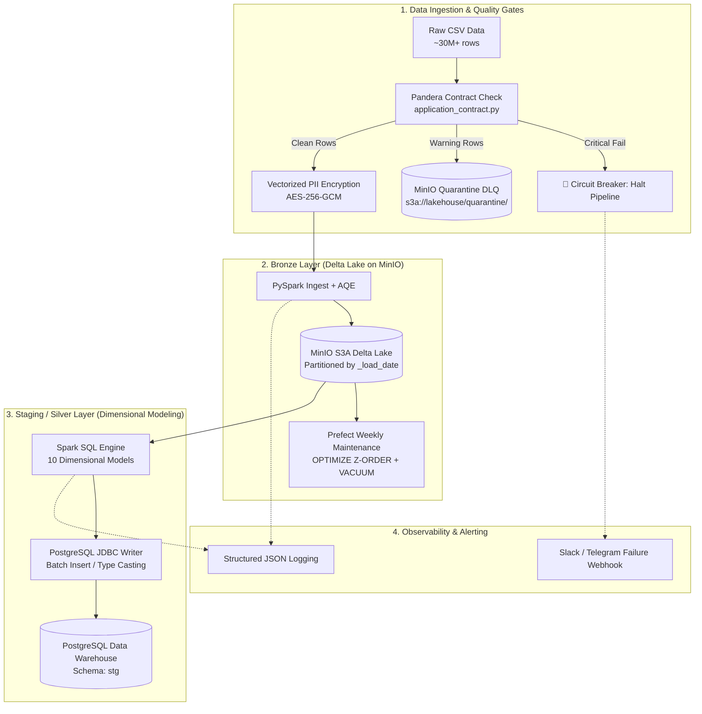

# 🏦 Home Credit Enterprise DataOps Pipeline

[](https://www.python.org/downloads/release/python-3110/)
[](https://spark.apache.org/)
[](https://delta.io/)
[](https://www.prefect.io/)
[](https://github.com/astral-sh/ruff)

Hệ thống DataOps Lakehouse kiến trúc **Medallion (Bronze → Staging/Silver)** xử lý dataset tín dụng ngân hàng Home Credit (~30M+ records) với **Data Quality Gates (Pandera)**, **Tối ưu hóa lưu trữ Delta Lake (Z-ORDER & VACUUM)**, **Bảo mật PII Crypto-Shredding (AES-256-GCM)** và điều phối bởi **Prefect Orchestrator**.

---

## 📑 Mục lục

1. [Tổng quan Kiến trúc](#1-tổng-quan-kiến-trúc)
2. [Các Tính Năng Cốt Lõi (Features)](#2-các-tính-năng-cốt-lõi-features)
3. [Tech Stack](#3-tech-stack)
4. [Cấu trúc Thư mục Dự án](#4-cấu-trúc-thư-mục-dự-án)
5. [Chuẩn Bị Dữ Liệu & Môi Trường](#5-chuẩn-bị-dữ-liệu--môi-trường)
6. [Hướng Dẫn Khởi Chạy (Docker & WSL)](#6-hướng-dẫn-khởi-chạy-docker--wsl)
7. [Kiểm Thử & Đảm Bảo Chất Lượng (Quality Gates)](#7-kiểm-thử--đảm-bảo-chất-lượng-quality-gates)
8. [Vận Hành & Bảo Trì Delta Lake](#8-vận-hành--bảo-trì-delta-lake)
9. [Xử Lý Sự Cố Thường Gặp (Troubleshooting)](#9-xử-lý-sự-cố-thường-gặp-troubleshooting)

---

## 1. Tổng quan Kiến trúc



---

## 2. Các Tính Năng Cốt Lõi (Features)

* **⚡ Production Spark Tuning (ST05):** Kích hoạt Adaptive Query Execution (AQE), dynamic partition coalescing, cấu hình bộ nhớ chống tràn ổ đĩa (Spill-to-Disk) và kiểm soát kích thước file (`maxRecordsPerFile`).
* **🛡️ Data Contracts & Circuit Breaker (ST04):** Kiểm tra hợp đồng dữ liệu thời gian thực với **Pandera PySpark**:
  - `CRITICAL`: Dừng pipeline ngay lập tức nếu dữ liệu sai khóa chính / null bất thường.
  - `WARNING`: Tách và cách ly bản ghi lỗi vào **Dead Letter Queue (DLQ)** trên MinIO, cho phép pipeline tiếp tục xử lý bản ghi sạch.
* **🧹 Delta Storage Maintenance (ST05):** Scheduled flow tự động thực hiện **`OPTIMIZE` (Z-ORDER)** sắp xếp đa chiều và **`VACUUM`** dọn snapshot cũ (> 7 ngày) chống phình to metadata.
* **🔒 PII Protection & GDPR Crypto-Shredding (ST03):** Vectorized Spark UDF mã hóa định danh khách hàng bằng **AES-256-GCM**. Hỗ trợ hủy dữ liệu ("Right to be Forgotten") chỉ bằng thao tác thu hồi Key trong KMS.
* **📊 Observability & Fast Alerting (ST06):** Hệ thống log định dạng chuẩn JSON cho mọi tác vụ kèm `run_id`, bảng, số dòng và webhook tự động gửi cảnh báo khi pipeline thất bại.
* **✅ Quality Gates (ST07):** Quy chuẩn linting tĩnh siêu tốc với **Ruff** và bộ test tự động **Pytest**.

---

## 3. Tech Stack

| Thành phần | Công nghệ | Phiên bản | Vai trò kỹ thuật |
| :--- | :--- | :---: | :--- |
| **Orchestrator** | Prefect Server | 2.20.25 | Điều phối Flow/Task, tracking lịch sử và trạng thái |
| **Compute Engine** | Apache Spark (PySpark) | 3.5.1 | Xử lý dữ liệu phân tán lớn (AQE + Memory Tuned) |
| **Storage Format** | Delta Lake | 3.1.0 | ACID Transactions, Time-travel, Z-Order Compaction |
| **Object Storage** | MinIO | latest | S3-compatible Lakehouse (Bronze + Quarantine DLQ) |
| **Database / DWH** | PostgreSQL | 14-alpine | Lưu trữ Staging Dimensional Tables (Schema: `stg`) |
| **Data Contract** | Pandera (PySpark) | 0.19.2 | Ràng buộc Schema, Rule validation và DLQ routing |
| **Linter / Formatter** | Ruff | 0.6.9 | Kiểm tra chuẩn code Python, fix lỗi cú pháp tự động |
| **Testing** | Pytest | 8.2.2 | Unit testing cho Contract, Config và Delta helpers |

---

## 4. Cấu trúc Thư mục Dự án

```text
DataOps_pipeline_HomeCredit/
├── cli/
│   ├── data_contract/
│   │   └── application_contract.py     # Pandera Data Contracts (CRITICAL vs WARNING)
│   ├── flows/
│   │   ├── config/
│   │   │   └── homecredit_config.yaml  # Config bảng, Z-Order keys, retention
│   │   ├── serving/
│   │   │   ├── bronze_flow.py          # Bronze Ingest: CSV → Delta (MinIO)
│   │   │   ├── silver_flow.py          # Silver Transform: Delta → PostgreSQL
│   │   │   ├── dq_validator.py         # Data Quality Gate & DLQ Router
│   │   │   ├── maintenance_flow.py     # Delta OPTIMIZE & VACUUM Maintenance
│   │   │   ├── daily_pipeline.py       # Master Orchestrator + Webhook Alert
│   │   │   └── metadata.py             # Config & Path Helper
│   │   └── sql/staging/                # 10 file SQL Dimensional Modeling (Kimball)
│   ├── ingestion/
│   │   └── source_data/                # Thư mục chứa CSV gốc (application.csv,...)
│   └── main.py                         # CLI Entrypoint chính
├── platforms/
│   ├── config/
│   │   └── delta_utils.py              # Generic Delta Read/Write, Compaction, Vacuum
│   ├── processing/
│   │   └── spark_stack/spark_session.py# Spark Session Factory (AQE + S3A LogStore)
│   └── security/
│       └── pii_encryptor.py            # Vectorized AES-256-GCM Encryption Engine
├── log/
│   └── config/logger_setup.py          # Structured JSON Logger Singleton
├── infra_homecredit/
│   ├── docker-compose.yml              # Cụm 5 containers: Postgres, MinIO, Prefect, Pipeline
│   └── Dockerfile                      # Image pipeline (Python 3.11 + OpenJDK 17)
├── tests/
│   ├── test_config.py                  # Unit test cấu trúc file cấu hình YAML
│   ├── test_contract.py                # Unit test Pandera Data Contract rules
│   ├── test_delta_utils.py             # Unit test Delta path generator
│   └── test_pii.py                     # Unit test AES-256-GCM & Crypto-Shredding
├── pyproject.toml                      # Cấu hình Ruff và Pytest
├── requirements.txt                    # Danh sách dependencies đã khóa version
├── config.py                           # Central project path locator
└── README.md
```

---

## 5. Chuẩn Bị Dữ Liệu & Môi Trường

### 1. Dữ liệu nguồn (Kaggle Dataset)
Tải bộ dữ liệu [Home Credit Default Risk](https://www.kaggle.com/c/home-credit-default-risk/data) và đặt các file CSV vào thư mục:
```text
cli/ingestion/source_data/
├── application.csv              (~307K rows)
├── bureau.csv                   (~1.7M rows)
├── bureau_balance.csv           (~27M rows)
├── previous_application.csv     (~1.7M rows)
├── installments_payments.csv    (~13.6M rows)
├── POS_CASH_balance.csv         (~10M rows)
└── credit_card_balance.csv      (~3.8M rows)
```

### 2. Thiết lập Biến môi trường
```bash
cp .env.example .env
```

---

## 6. Hướng Dẫn Khởi Chạy (Docker & WSL)

### Cách 1: Chạy Full Pipeline bằng Docker Compose (Khuyến nghị)

```bash
cd infra_homecredit

# 1. Khởi động hạ tầng nền (Postgres, MinIO, Prefect Server)
docker compose up -d postgres minio minio-init prefect-server

# 2. Build image và thực thi Master Pipeline Flow
docker compose run --rm pipeline python -m cli.main
```

### Cách 2: Chạy trực tiếp trên máy cục bộ / WSL (Dev Mode)

```bash
# 1. Kích hoạt virtualenv (Python 3.11) và cài đặt dependencies
source .venv/bin/activate
pip install -r requirements.txt

# 2. Khởi chạy full pipeline
python -m cli.main
```

---

## 7. Kiểm Thử & Đảm Bảo Chất Lượng (Quality Gates)

Trước khi commit hoặc push code, thực thi bộ kiểm tra chất lượng tự động:

```bash
# 1. Kiểm tra và tự động fix chuẩn cú pháp bằng Ruff
ruff check --fix .
ruff format .

# 2. Chạy toàn bộ Unit & Data Contract Tests
pytest tests/ -v
```

---

## 8. Vận Hành & Bảo Trì Delta Lake

Để giải quyết tình trạng **Small Files** và giải phóng dung lượng snapshot cũ, kích hoạt Flow bảo trì định kỳ:

```bash
# Chạy OPTIMIZE (Z-ORDER theo khóa chính) và VACUUM (xóa snapshot > 168 giờ)
docker compose run --rm pipeline python -c "from cli.flows.serving.maintenance_flow import delta_maintenance_flow; delta_maintenance_flow()"
```

### Dashboard & Cổng Quản Trị
* **Prefect UI:** [http://localhost:4201](http://localhost:4201) (Theo dõi trạng thái và thời gian chạy của Flow/Task)
* **MinIO Console:** [http://localhost:9003](http://localhost:9003) (User: `minioadmin` / Pass: `change_me`)
* **PostgreSQL:** `localhost:5433` (DB: `homecredit_mart`, Schema: `stg`)

---

## 9. Xử Lý Sự Cố Thường Gặp (Troubleshooting)

| Lỗi / Hiện tượng | Nguyên nhân | Cách khắc phục |
| :--- | :--- | :--- |
| `AttributeError: np.string_ was removed in NumPy 2.0` | Pandera 0.19.2 không tương thích NumPy 2.x | Khóa version `numpy==1.26.4` trong `requirements.txt`. |
| `TimeoutError trong asgi_lifespan` | Prefect Client không kết nối được Server và bị treo khi khởi tạo SQLite | Đảm bảo biến `PREFECT_API_URL=http://prefect-server:4200/api` trong `docker-compose.yml`. |
| `DataQualityError: CRITICAL contract violated` | Dữ liệu đầu vào vi phạm tính toàn vẹn (Null PK, Target sai dải giá trị) | Pipeline tự động ngắt bảo vệ Data Lake (Circuit Breaker). Kiểm tra log chi tiết để xác định dòng lỗi. |
| Spark OOM / JVM Heap Crash khi chạy `bureau_balance` | Dữ liệu lớn (~27M rows) bị dồn bộ nhớ khi shuffle | Tăng `SPARK_DRIVER_MEMORY` trong `.env` hoặc giảm `max_records_per_file` xuống `200000`. |
