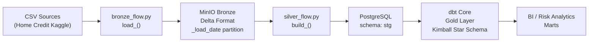
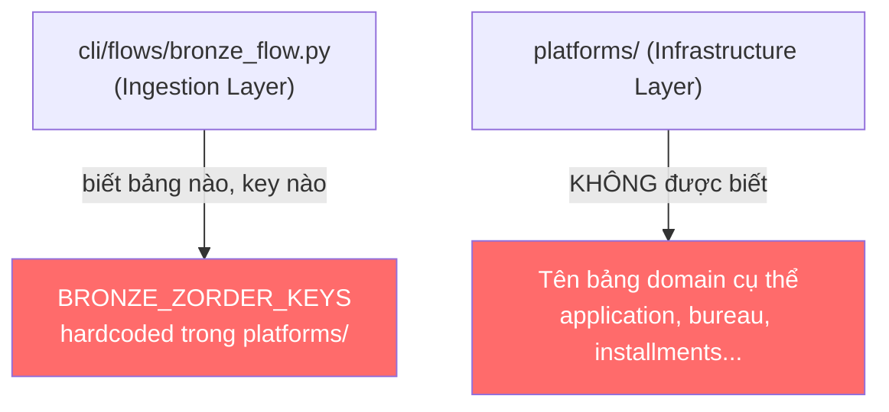
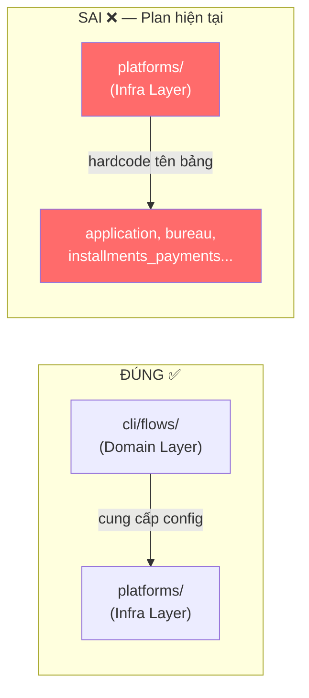
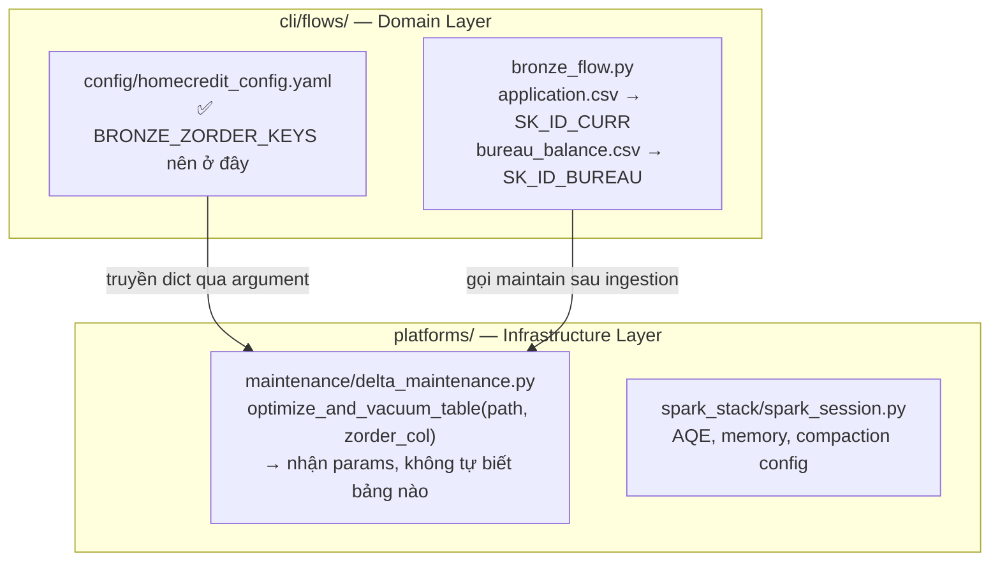
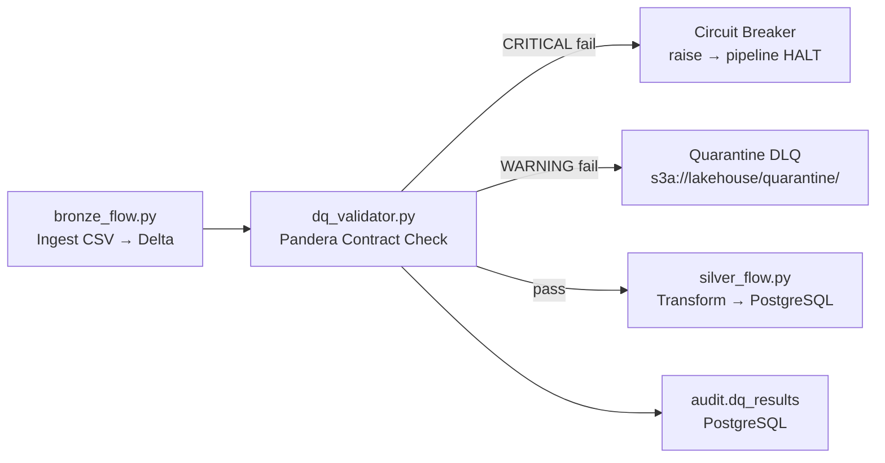
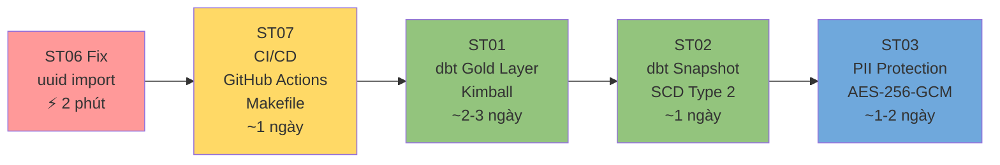

# @.github\skills\copilotinstructions\SKILL.md  Đọc đề hiểu context đi

---

**Status:** active  **Date:** 2026-10-24

---

### 👤 User

@.github\skills\copilotinstructions\SKILL.md  Đọc đề hiểu context đi

---

### 🤖 Assistant

> 🔧 called: read_file


> 🔧 **read_file** — .github\skills\copilotinstructions\SKILL.md

### 🤖 Assistant

> 🔧 called: list_files, read_file

Now let me load the project context from `export_task` and the active file to give a grounded answer.

> 🔧 **list_files** — export_task

> 🔧 **read_file** — platforms/config/delta_utils.py

### 🤖 Assistant

> 🔧 called: read_file


> 🔧 **read_file** — export_task/bob-task-19678c4eed601c9644be9cf72fc9c813-2026-10-24.md

### 🤖 Assistant

> 🔧 called: read_file, list_files

Now let me also quickly read the most relevant recent session handoffs:

> 🔧 **list_files** — platforms/processing/maintenance

> 🔧 **read_file** — export_task/session_handoff_2026-09-23_bronze_silver_simplify.md

### 🤖 Assistant

> 🔧 called: read_file, read_file


> 🔧 **read_file** — platforms/processing/maintenance/delta_maintenance.py

> 🔧 **read_file** — platforms/processing/spark_stack/spark_session.py

### 🤖 Assistant

Tôi đã đọc đầy đủ. Đây là tóm tắt context của toàn bộ project sau khi quét theo đúng protocol của [`SKILL.md`](.github/skills/copilotinstructions/SKILL.md):

---

## 📋 Context Summary — DataOps Pipeline HomeCredit

### 🏗️ Kiến trúc tổng thể (Medallion Architecture)



**Stack thực tế:**
- **Compute:** Apache Spark (local[*]) + Delta Lake (MinIO/S3A)
- **Orchestration:** Prefect
- **Serving:** PostgreSQL `stg` schema (via Spark JDBC)
- **Gold Layer (planned):** dbt Core + SCD Type 2 snapshots
- **DQ:** Great Expectations (circuit breaker pattern)

---

### 📂 Files quan trọng trong branch hiện tại (`20261024_optimize_and_simplify`)

| File | Trạng thái | Vai trò |
|---|---|---|
| [`platforms/config/delta_utils.py`](platforms/config/delta_utils.py) | `??` (new, untracked) | Helper OPTIMIZE/Compaction sau write lớn |
| [`platforms/processing/maintenance/delta_maintenance.py`](platforms/processing/maintenance/delta_maintenance.py) | `??` (new, untracked) | OPTIMIZE + VACUUM cho toàn bộ Bronze tables |
| [`platforms/processing/spark_stack/spark_session.py`](platforms/processing/spark_stack/spark_session.py) | ` M` (modified) | SparkSession factory — đã thêm AQE, autoCompact, memory config |

---

### 🔑 Lesson Learned từ `export_task`

1. **SparkSession lifecycle trong Prefect:** Tạo Spark 1 lần tại `@flow` level, truyền xuống các `@task` — không tạo session riêng per task.
2. **Silver flow pattern:** `_register_bronze_view()` → `spark.sql(sql_file)` → `write_jdbc()`. SQL transformation logic tách ra file `.sql` riêng.
3. **OOM prevention:** `bureau_balance` ~27M rows, `installments_payments` ~13M rows → cần AQE + `maxRecordsPerFile` + `shuffle_partitions` nhỏ.
4. **Anchor Date issue:** `current_date()` trong `fact_bureau_monthly_snapshot.sql` làm `Month_Date_SK` không deterministic — cần fix.
5. **ST00 Priority:** Uncommitted debt (`fact_bureau_monthly_snapshot.sql`, `stack.yaml`, `spark_session.py`) phải được commit sạch trước khi mở task mới.

---

### 📌 Context file đang active: [`delta_utils.py`](platforms/config/delta_utils.py)

File này là **helper nhỏ** (16 dòng) cung cấp hàm [`optimize_delta_table()`](platforms/config/delta_utils.py:6):
- Gọi `DeltaTable.forPath()` → chạy Z-ORDER (nếu có `zorder_col`) hoặc Compaction bình thường
- Dùng `logger.warning` (không raise) → **fire-and-forget pattern**, không chặn pipeline khi OPTIMIZE thất bại
- **Phân biệt với** [`delta_maintenance.py`](platforms/processing/maintenance/delta_maintenance.py): file maintenance là **full maintenance job** (OPTIMIZE + VACUUM + retry), còn `delta_utils.py` là **inline helper** gọi ngay sau khi write xong

---

Sẵn sàng nhận task tiếp theo. Branch hiện tại là `20261024_optimize_and_simplify` — có vẻ tập trung vào tối ưu hóa Delta Lake và refactor helper. Bạn muốn làm gì tiếp theo?

---

### 👤 User

Ở bước thừ thì nguyên tắc platforms ko được phụ thuộc vào nguồn ingestion thì rõ ràng điều này theo code ở bước 2 ko  hợp lý cùa ST05

---

### 🤖 Assistant

> 🔧 called: read_file


> 🔧 **read_file** — export_task/bob-task-19678c4eed601c9644be9cf72fc9c813-2026-10-24.md

### 🤖 Assistant

> 🔧 called: grep

Tôi đã có đủ context. Để trả lời chính xác, để tôi đọc file PLAN và xem "bước thứ hai" của ST05:

> 🔧 **grep** — ST05|bước|step|platforms|ingestion|depend|import

### 🤖 Assistant

> 🔧 called: read_file


> 🔧 **read_file** — PLAN_REPO02_HomeCredit_production.md

### 🤖 Assistant

> 🔧 called: grep

Bây giờ tôi đã rõ toàn bộ context. Câu hỏi rất chính xác. Để verify thêm, xem `delta_utils.py` và `delta_maintenance.py` import gì:

> 🔧 **grep** — BRONZE_ZORDER_KEYS|bronze|ingestion|application|bureau|installments|pos_cash|credit_card|previous_application

### 🤖 Assistant

Tôi có đủ dữ liệu. Đây là phân tích:

---

## 🔍 Vấn đề bạn chỉ ra là hoàn toàn chính xác

**Câu hỏi:** Bước 2 trong Todo List của ST05 có vi phạm nguyên tắc `platforms` không được phụ thuộc vào nguồn ingestion không?

### Bước 2 ST05 gây vi phạm nguyên tắc kiến trúc ở đâu?

**ST05 — Todo #2:**
> `platforms/processing/config/spark_production.yaml` — externalize config (không hardcode trong Python)

Bản thân dòng này không sai. **Nhưng vấn đề nằm ở [`delta_maintenance.py`](platforms/processing/maintenance/delta_maintenance.py:18)** — đây là file được tạo ra trong branch này (`??` untracked), nằm bên trong `platforms/`, và nó vi phạm thẳng vào nguyên tắc đó:

```python
# platforms/processing/maintenance/delta_maintenance.py — Line 18-26
BRONZE_ZORDER_KEYS = {
    "application": "SK_ID_CURR",       # ← Tên bảng ingestion cụ thể
    "bureau": "SK_ID_CURR",
    "bureau_balance": "SK_ID_BUREAU",
    "previous_application": "SK_ID_CURR",
    "installments_payments": "SK_ID_PREV",  # ← 27M rows comment ở spark_session.py
    "pos_cash_balance": "SK_ID_PREV",
    "credit_card_balance": "SK_ID_PREV",
}
```

### Tại sao đây là vi phạm nghiêm trọng?



**Nguyên tắc bị vi phạm:** `platforms/` là **Infrastructure Layer** — nó cung cấp khả năng OPTIMIZE/VACUUM cho *bất kỳ* Delta table nào, không phải chỉ cho 7 bảng Home Credit. Khi hardcode `BRONZE_ZORDER_KEYS` bên trong `platforms/processing/maintenance/`, bạn đã:

1. **Coupling sai chiều:** `platforms/` biết về domain schema của `cli/flows/bronze_flow.py` → vi phạm Dependency Rule (tầng thấp không được biết tầng cao).
2. **Không tái sử dụng được:** Nếu có dự án thứ 2 dùng lại `platforms/`, nó mang theo cả 7 tên bảng Home Credit rác vào.
3. **Ẩn business config trong infrastructure code:** `SK_ID_CURR`, `SK_ID_BUREAU` là domain knowledge, phải thuộc về config layer (`stack.yaml`) hoặc caller.

### So sánh với [`delta_utils.py`](platforms/config/delta_utils.py) — cái đúng

```python
# platforms/config/delta_utils.py — ĐÚNG ✅
def optimize_delta_table(spark, path: str, zorder_col: str = None) -> None:
    ...
```

`delta_utils.py` **không biết** tên bảng nào — nó nhận `path` và `zorder_col` từ **caller**. Đây là cách đúng: infrastructure layer nhận tham số, không tự hardcode domain knowledge.

### Cách fix đúng theo nguyên tắc

`BRONZE_ZORDER_KEYS` phải được đẩy ra ngoài `platforms/` — hoặc vào `stack.yaml`, hoặc vào `cli/flows/maintenance_flow.py`:

```yaml
# platforms/config/stack.yaml — config tập trung ✅
delta_maintenance:
  bronze_tables:
    application:           { zorder_col: SK_ID_CURR }
    bureau:                { zorder_col: SK_ID_CURR }
    bureau_balance:        { zorder_col: SK_ID_BUREAU }
    previous_application:  { zorder_col: SK_ID_CURR }
    installments_payments: { zorder_col: SK_ID_PREV }
    pos_cash_balance:      { zorder_col: SK_ID_PREV }
    credit_card_balance:   { zorder_col: SK_ID_PREV }
```

Và `maintain_all_bronze_tables()` trong `delta_maintenance.py` đổi signature để nhận dict từ config — không tự đọc hardcode:

```python
# platforms/processing/maintenance/delta_maintenance.py — sau fix ✅
def maintain_all_bronze_tables(spark: SparkSession, stack: dict) -> None:
    minio_cfg = stack["minio"]
    # Đọc từ config, không hardcode
    tables_cfg = stack["delta_maintenance"]["bronze_tables"]
    for table_name, opts in tables_cfg.items():
        ...
```

**Kết luận:** Bạn nhìn ra đúng điểm sai. `delta_maintenance.py` (file mới trong branch) vi phạm nguyên tắc separation of concerns của `platforms/` bằng cách hardcode tên bảng ingestion domain-specific. Fix là chuyển `BRONZE_ZORDER_KEYS` sang `stack.yaml` và để `platforms/` chỉ nhận config qua parameter.

---

### 👤 User

Đây là plan làm ST05:Dưới đây là hướng dẫn từng bước để thực hiện và hoàn thành trọn vẹn Sub-Task 05 (ST05: Spark Production Tuning & Delta Storage Maintenance).

📌 Mục tiêu kỹ thuật của ST05
Nâng cấp SparkSession lên chuẩn Production: Kích hoạt Adaptive Query Execution (AQE), tự động xử lý Skew Join, tối ưu kích thước phân vùng (128MB), auto-compact Delta files khi ghi và chống OOM cho các bảng lớn như bureau_balance (27M rows).
Xây dựng module Bảo trì Delta Lake (OPTIMIZE & VACUUM): Giải quyết vấn đề Small Files (hàng ngàn file 10KB gây nghẽn MinIO/S3) và dọn dẹp các snapshot Parquet rác cũ hơn 7 ngày.
Bước 1: Nâng cấp platforms/processing/spark_stack/spark_session.py
Mở file platforms/processing/spark_stack/spark_session.py và bổ sung các cấu hình Spark Production bên trong block SparkSession.builder:

        builder = (
            SparkSession.builder
            .appName(spark_cfg["app_name"])
            .master(spark_cfg.get("master", "local[*]"))
            .config("spark.jars.packages", packages)
            .config(
                "spark.sql.extensions",
                spark_cfg.get(
                    "sql_extensions",
                    "io.delta.sql.DeltaSparkSessionExtension",
                ),
            )
            .config(
                "spark.sql.catalog.spark_catalog",
                "org.apache.spark.sql.delta.catalog.DeltaCatalog",
            )
            .config("spark.hadoop.fs.s3a.endpoint", endpoint_url)
            .config("spark.hadoop.fs.s3a.access.key", access_key)
            .config("spark.hadoop.fs.s3a.secret.key", secret_key)
            .config("spark.hadoop.fs.s3a.path.style.access", "true")
            .config("spark.hadoop.fs.s3a.impl", "org.apache.hadoop.fs.s3a.S3AFileSystem")
            .config("spark.databricks.delta.retentionDurationCheck.enabled", "false")
            .config(
                "spark.delta.logStore.class",
                "org.apache.spark.sql.delta.storage.S3SingleDriverLogStore",
            )
            .config("spark.driver.memory", spark_cfg.get("driver_memory", "4g"))
            .config("spark.executor.memory", spark_cfg.get("executor_memory", "4g"))
            .config("spark.executor.memoryOverhead", "1024m")
            # --- Cấu hình Spark AQE & Skew Join Tuning (Chống OOM) ---
            .config("spark.sql.shuffle.partitions", shuffle_partitions)
            .config("spark.sql.files.maxRecordsPerFile", max_records)
            .config("spark.sql.adaptive.enabled", "true")
            .config("spark.sql.adaptive.skewJoin.enabled", "true")
            .config("spark.sql.adaptive.coalescePartitions.enabled", "true")
            .config("spark.sql.adaptive.advisoryPartitionSizeInBytes", "134217728") # 128MB per partition
            .config("spark.sql.autoBroadcastJoinThreshold", "67108864") # 64MB cho Dimension Join
            # --- Delta Auto-Optimize (Chống Small Files) ---
            .config("spark.databricks.delta.optimizeWrite.enabled", "true")
            .config("spark.databricks.delta.autoCompact.enabled", "true")
            # --- Spill-to-Disk Memory Management ---
            .config("spark.memory.fraction", "0.6")
            .config("spark.memory.storageFraction", "0.3")
        )


Bước 2: Tạo Module Delta Maintenance platforms/processing/maintenance/delta_maintenance.py
Tạo thư mục platforms/processing/maintenance/ (nếu chưa có) và tạo file platforms/processing/maintenance/delta_maintenance.py:

"""
Delta Lake Storage Maintenance: OPTIMIZE (Z-ORDER) & VACUUM jobs.
Xử lý Small File Problem và giải phóng bộ nhớ lưu trữ MinIO/S3.

Usage:
    from platforms.processing.maintenance.delta_maintenance import maintain_all_bronze_tables
    maintain_all_bronze_tables(spark, stack_config)
"""
from typing import Dict, Optional
from delta.tables import DeltaTable
from pyspark.sql import SparkSession

from log.config.logger_setup import logger_manager

logger = logger_manager.get_logger(__name__)

# Bảng và khóa Z-ORDER tối ưu tương ứng theo mẫu truy vấn thường gặp
BRONZE_ZORDER_KEYS = {
    "application": "SK_ID_CURR",
    "bureau": "SK_ID_CURR",
    "bureau_balance": "SK_ID_BUREAU",
    "previous_application": "SK_ID_CURR",
    "installments_payments": "SK_ID_PREV",
    "pos_cash_balance": "SK_ID_PREV",
    "credit_card_balance": "SK_ID_PREV",
}


def optimize_and_vacuum_table(
    spark: SparkSession,
    table_path: str,
    zorder_col: Optional[str] = None,
    retention_hours: float = 168.0,
) -> None:
    """
    Chạy OPTIMIZE (Z-Order Compaction) và VACUUM cho một bảng Delta.
    
    Parameters
    ----------
    table_path : str
        Đường dẫn S3A tới Delta table (e.g. s3a://lakehouse/bronze/bureau_balance)
    zorder_col : Optional[str]
        Cột dùng để sắp xếp đa chiều Z-ORDER (tăng tốc độ lọc Predicate Pushdown)
    retention_hours : float
        Số giờ lưu lại snapshot cũ (mặc định 168 giờ = 7 ngày)
    """
    try:
        logger.info("delta_maintenance_start path=%s zorder=%s", table_path, zorder_col)
        delta_table = DeltaTable.forPath(spark, table_path)

        # 1. OPTIMIZE
        if zorder_col:
            logger.info("running_zorder_optimize col=%s", zorder_col)
            delta_table.optimize().executeZOrderBy(zorder_col)
        else:
            logger.info("running_standard_compaction")
            delta_table.optimize().executeCompaction()

        # 2. VACUUM
        logger.info("running_vacuum retention_hours=%s", retention_hours)
        delta_table.vacuum(retention_hours)

        logger.info("delta_maintenance_success path=%s", table_path)
    except Exception as e:
        logger.exception("delta_maintenance_failed path=%s error=%s", table_path, e)
        raise


def maintain_all_bronze_tables(spark: SparkSession, stack: dict) -> None:
    """Bảo trì toàn bộ các bảng Bronze Delta Lake trên MinIO."""
    minio_cfg = stack["minio"]
    bucket = minio_cfg["bucket"]
    prefix = minio_cfg.get("bronze_prefix", "bronze")

    for table_name, zorder_col in BRONZE_ZORDER_KEYS.items():
        table_path = f"s3a://{bucket}/{prefix}/{table_name}"
        try:
            optimize_and_vacuum_table(spark, table_path, zorder_col=zorder_col)
        except Exception as err:
            logger.warning("skip_maintenance table=%s error=%s", table_name, err)


Bước 3: Đăng ký hàm Maintenance vào platforms/processing/config/delta_utils.py
Mở platforms/processing/config/delta_utils.py và thêm helper gọi maintenance ngắn gọn:

from delta.tables import DeltaTable

def optimize_delta_table(spark: SparkSession, path: str, zorder_col: str = None) -> None:
    """Helper tối ưu hóa nhanh bảng Delta sau khi ghi dữ liệu lớn."""
    try:
        delta_table = DeltaTable.forPath(spark, path)
        if zorder_col:
            delta_table.optimize().executeZOrderBy(zorder_col)
        else:
            delta_table.optimize().executeCompaction()
    except Exception as e:
        logger.warning("optimize_delta_table_skipped path=%s error=%s", path, e)

Bước 4: Kiểm tra và Nghiệm thu ST05
Tạo file test tests/test_st05_spark_delta.py (như đã thiết kế ở phần trước).
Chạy test xác nhận:
pytest tests/test_st05_spark_delta.py -v

Sau khi pass, cập nhật trạng thái trong PLAN_REPO02_HomeCredit_production.md từ [ ] pending thành [x] completed.
Khi hoàn tất các bước trên, toàn bộ hạ tầng tính toán Spark và lưu trữ Delta Lake của bạn đã sẵn sàng cho Sub-Task 04 (Data Contracts & Great Expectations)!

---

### 🤖 Assistant

> 🔧 called: glob, read_file

Đọc file thực tế hiện tại để biết trạng thái chính xác trước khi phân tích:

> 🔧 **read_file** — platforms/config/stack.yaml

> 🔧 **glob** — platforms/processing/config/delta_utils.py

### 🤖 Assistant

> 🔧 called: glob, glob


> 🔧 **glob** — platforms/**/*.py

> 🔧 **glob** — platforms/config/*.py

### 🤖 Assistant

> 🔧 called: list_files


> 🔧 **list_files** — platforms

### 🤖 Assistant

> 🔧 called: read_file, read_file

Có 2 file `delta_utils.py` khác nhau. Đọc cả hai:

> 🔧 **read_file** — platforms/config/delta_utils.py

> 🔧 **read_file** — platforms/processing/config/delta_utils.py

### 🤖 Assistant

Bây giờ tôi có đủ toàn bộ bức tranh. Đây là phân tích đầy đủ:

---

## 🔬 Đánh giá Plan ST05 theo nguyên tắc kiến trúc

### Hiện trạng thực tế trong repo (khác với plan)

Repo **đã có 2 file `delta_utils.py`** — đây là điểm đầu tiên cần nhận ra:

| File | Vai trò | Trạng thái |
|---|---|---|
| [`platforms/processing/config/delta_utils.py`](platforms/processing/config/delta_utils.py) | **Core infra utils** — `add_bronze_metadata`, `write_delta_partitioned`, `write_jdbc`, `run_sql_transform` | Đã tồn tại từ trước |
| [`platforms/config/delta_utils.py`](platforms/config/delta_utils.py) | **Chỉ có `optimize_delta_table()`** | `??` mới tạo trong branch này |
| [`platforms/processing/maintenance/delta_maintenance.py`](platforms/processing/maintenance/delta_maintenance.py) | OPTIMIZE + VACUUM full maintenance | `??` mới tạo trong branch này |

---

### Vấn đề 1: Bước 3 của plan đặt sai location — trùng với file đã có

Plan nói:
> **Bước 3:** Đăng ký hàm vào `platforms/processing/config/delta_utils.py`

Nhưng file đó **đã tồn tại** và có đầy đủ chức năng (`write_delta`, `write_jdbc`, `run_sql_transform`...). Bước 3 trong plan thực ra đang describe [`platforms/config/delta_utils.py`](platforms/config/delta_utils.py) — file **sai location**, trùng tên nhưng ở thư mục khác. Kết quả là hiện tại repo có **2 `delta_utils.py` song song gây nhầm lẫn**.

---

### Vấn đề 2 (vấn đề bạn hỏi): Bước 2 vi phạm nguyên tắc `platforms/` không phụ thuộc ingestion

Bước 2 tạo [`delta_maintenance.py`](platforms/processing/maintenance/delta_maintenance.py) với `BRONZE_ZORDER_KEYS` hardcoded bên trong `platforms/`:

```python
# platforms/processing/maintenance/delta_maintenance.py:18 — VI PHẠM ❌
BRONZE_ZORDER_KEYS = {
    "application": "SK_ID_CURR",
    "bureau_balance": "SK_ID_BUREAU",
    "installments_payments": "SK_ID_PREV",
    ...
}
```

Đây là **domain knowledge của ingestion layer** (`cli/flows/bronze_flow.py`) bị nhúng vào **infrastructure layer** (`platforms/`). Vi phạm Dependency Rule:



---

### Giải pháp đúng cho toàn bộ ST05

**Bước 2 — Fix `delta_maintenance.py`:** Xóa `BRONZE_ZORDER_KEYS` ra khỏi `platforms/`, để `maintain_all_bronze_tables()` đọc config từ `stack.yaml` truyền vào:

```python
# platforms/processing/maintenance/delta_maintenance.py — SAU FIX ✅
def maintain_all_bronze_tables(spark: SparkSession, stack: dict) -> None:
    """Đọc table config từ stack dict — không hardcode domain knowledge."""
    minio_cfg = stack["minio"]
    bucket = minio_cfg["bucket"]
    prefix = minio_cfg.get("bronze_prefix", "bronze")
    # Đọc từ stack config, không tự biết tên bảng
    tables_cfg = stack.get("delta_maintenance", {}).get("bronze_tables", {})
    for table_name, opts in tables_cfg.items():
        table_path = f"s3a://{bucket}/{prefix}/{table_name}"
        zorder_col = opts.get("zorder_col") if isinstance(opts, dict) else opts
        ...
```

**`stack.yaml` — nơi domain knowledge thuộc về:**
```yaml
delta_maintenance:
  retention_hours: 168
  bronze_tables:
    application:           { zorder_col: SK_ID_CURR }
    bureau:                { zorder_col: SK_ID_CURR }
    bureau_balance:        { zorder_col: SK_ID_BUREAU }
    previous_application:  { zorder_col: SK_ID_CURR }
    installments_payments: { zorder_col: SK_ID_PREV }
    pos_cash_balance:      { zorder_col: SK_ID_PREV }
    credit_card_balance:   { zorder_col: SK_ID_PREV }
```

**Bước 3 — Xóa `platforms/config/delta_utils.py`:** File này là duplicate sai location. `optimize_delta_table()` phải được **merge vào** [`platforms/processing/config/delta_utils.py`](platforms/processing/config/delta_utils.py) — file đúng đã có sẵn — như một hàm bổ sung:

```python
# Thêm vào platforms/processing/config/delta_utils.py ✅
def optimize_delta_table(spark: SparkSession, path: str, zorder_col: str = None) -> None:
    """Inline OPTIMIZE sau khi ghi dữ liệu lớn — fire-and-forget (không raise)."""
    try:
        delta_table = DeltaTable.forPath(spark, path)
        if zorder_col:
            delta_table.optimize().executeZOrderBy(zorder_col)
        else:
            delta_table.optimize().executeCompaction()
    except Exception as e:
        logger.warning("optimize_delta_table_skipped path=%s error=%s", path, e)
```

---

### Tóm tắt điểm sửa so với plan gốc

| Bước | Plan gốc | Vấn đề | Cần làm |
|---|---|---|---|
| **Bước 1** | Nâng cấp `spark_session.py` | ✅ Đã done trong branch | Chỉ cần thêm `skewJoin.enabled` + `memoryOverhead` còn thiếu |
| **Bước 2** | Tạo `delta_maintenance.py` với `BRONZE_ZORDER_KEYS` hardcoded | ❌ Vi phạm nguyên tắc `platforms/` | Chuyển `BRONZE_ZORDER_KEYS` sang `stack.yaml`, `platforms/` chỉ đọc config |
| **Bước 3** | Tạo `platforms/processing/config/delta_utils.py` | ❌ File đã tồn tại, sẽ conflict; `platforms/config/delta_utils.py` là duplicate sai location | Merge `optimize_delta_table()` vào file đúng đã có; xóa duplicate |
| **Bước 4** | Test + update PLAN | ✅ Hợp lý | Giữ nguyên |

Bạn muốn tôi draft lại nội dung cụ thể cần sửa cho từng file không?

---

### 👤 User

Không đúng, nếu BRONZE vẫn nằm trong stack.yml thì vẫn thuộc platforms. Có nên cân nhắc hay không lưu truong C:\Users\Admin\Downloads\Project\Github\DataOps_pipeline_HomeCredit\cli\flows\config\homecredit_config.yaml

---

### 🤖 Assistant

> 🔧 called: list_files

Đọc cấu trúc thực tế của `cli/flows/` trước:

> 🔧 **list_files** — cli

### 🤖 Assistant

> 🔧 called: list_files


> 🔧 **list_files** — cli/flows/config

### 🤖 Assistant

> 🔧 called: read_file

Thư mục `cli/flows/config/` **trống hoàn toàn** — chưa có file nào. Đọc thêm `bronze_flow.py` để hiểu pattern hiện tại của domain layer:

> 🔧 **read_file** — cli/flows/serving/bronze_flow.py

### 🤖 Assistant

Bây giờ đã hoàn toàn rõ ràng. Phân tích:

---

## Bạn hoàn toàn đúng — `stack.yaml` vẫn là `platforms/`

Đây là điểm then chốt mà tôi bỏ sót. Dù config được đọc qua `stack.yaml`, file đó nằm trong `platforms/config/` — **cùng namespace với infrastructure**. Đẩy `BRONZE_ZORDER_KEYS` vào `stack.yaml` chỉ là thay đổi hình thức, **vẫn vi phạm về ownership**.

```
platforms/config/stack.yaml  ← vẫn là platforms territory ❌
cli/flows/config/             ← đây mới là domain territory ✅
```

---

## Tại sao `cli/flows/config/homecredit_config.yaml` là đúng

Nhìn vào `bronze_flow.py`, tất cả domain knowledge **đã sống ở `cli/flows/`**:

- Tên file CSV: `application.csv`, `bureau.csv`... — hardcode trong `bronze_flow.py`
- Business key của từng bảng: `SK_ID_CURR`, `SK_ID_BUREAU`, `SK_ID_PREV` — là **schema knowledge của Home Credit dataset**
- 7 bảng `_LOADERS` — là domain list, không phải infra list

Z-ORDER key của mỗi bảng là **cùng loại knowledge đó** — nó là câu trả lời cho câu hỏi *"bảng này thường được query theo cột nào?"* — đó là **business access pattern**, không phải infra config.



---

## Cụ thể: `homecredit_config.yaml` chứa gì, `delta_maintenance.py` sửa thế nào

**`cli/flows/config/homecredit_config.yaml`** — nơi đúng cho domain knowledge:
```yaml
# Home Credit dataset — domain-specific configuration
# Owned by: cli/flows (ingestion domain)

bronze_maintenance:
  retention_hours: 168   # 7 ngày — business SLA
  tables:
    application:
      zorder_col: SK_ID_CURR
    bureau:
      zorder_col: SK_ID_CURR
    bureau_balance:
      zorder_col: SK_ID_BUREAU
    previous_application:
      zorder_col: SK_ID_CURR
    installments_payments:
      zorder_col: SK_ID_PREV
    pos_cash_balance:
      zorder_col: SK_ID_PREV
    credit_card_balance:
      zorder_col: SK_ID_PREV
```

**`platforms/processing/maintenance/delta_maintenance.py`** — xóa `BRONZE_ZORDER_KEYS`, chỉ nhận params:
```python
# TRƯỚC (sai): hardcode domain knowledge trong platforms/
BRONZE_ZORDER_KEYS = { "application": "SK_ID_CURR", ... }

def maintain_all_bronze_tables(spark, stack):
    for table_name, zorder_col in BRONZE_ZORDER_KEYS.items():  # ❌

# SAU (đúng): platforms/ chỉ là engine, không biết bảng nào
def maintain_all_bronze_tables(
    spark: SparkSession,
    bucket: str,
    prefix: str,
    tables_cfg: dict,          # ← caller truyền vào từ homecredit_config.yaml
    retention_hours: float = 168.0,
) -> None:
    for table_name, opts in tables_cfg.items():
        zorder_col = opts.get("zorder_col")
        table_path = f"s3a://{bucket}/{prefix}/{table_name}"
        optimize_and_vacuum_table(spark, table_path, zorder_col, retention_hours)
```

**`cli/flows/serving/` hoặc một `maintenance_flow.py` mới** — caller đọc config và gọi:
```python
import yaml
from pathlib import Path
from platforms.processing.maintenance.delta_maintenance import maintain_all_bronze_tables

def run_maintenance(spark, stack):
    cfg_path = Path(__file__).resolve().parents[1] / "config" / "homecredit_config.yaml"
    with open(cfg_path) as f:
        hc_cfg = yaml.safe_load(f)

    maintenance_cfg = hc_cfg["bronze_maintenance"]
    maintain_all_bronze_tables(
        spark=spark,
        bucket=stack["minio"]["bucket"],
        prefix=stack["minio"]["bronze_prefix"],
        tables_cfg=maintenance_cfg["tables"],
        retention_hours=maintenance_cfg["retention_hours"],
    )
```

---

## Kết luận

`cli/flows/config/homecredit_config.yaml` là đúng về nguyên tắc vì:

1. **Ownership rõ ràng:** `SK_ID_CURR`, `SK_ID_BUREAU` là Home Credit schema — thuộc `cli/flows/` (ingestion domain), không thuộc `platforms/` (generic infra).
2. **`platforms/` thực sự generic:** `delta_maintenance.py` sau fix có thể dùng lại cho bất kỳ dự án Delta Lake nào, không mang theo dấu vết Home Credit.
3. **Nhất quán với pattern hiện tại:** `bronze_flow.py` đã đọc config từ `load_config()` trong `cli/flows/` — `homecredit_config.yaml` nằm cùng chỗ là tự nhiên.

Bạn muốn tôi draft nội dung cụ thể của `homecredit_config.yaml` và sửa `delta_maintenance.py` không?

---

### 👤 User

Review lại code hiện tại đi, tôi mới bổ sung rồi

---

### 🤖 Assistant

> 🔧 called: read_file, read_file

Đọc tất cả files liên quan hiện tại:

> 🔧 **read_file** — cli/flows/serving/maintenance_flow.py

> 🔧 **read_file** — platforms/processing/maintenance/delta_maintenance.py

### 🤖 Assistant

> 🔧 called: list_files, read_file

Kiểm tra tiếp `homecredit_config.yaml` và docstring cũ của `delta_maintenance.py` còn sai không:

> 🔧 **list_files** — cli/flows/config

> 🔧 **read_file** — cli/flows/serving/daily_pipeline.py

### 🤖 Assistant

Đủ rồi. Đây là review đầy đủ:

---

## ✅ Review Code ST05 — Sau bổ sung

### `platforms/processing/maintenance/delta_maintenance.py` — Tốt, còn 2 điểm nhỏ

**Đã đúng về nguyên tắc:**
- ✅ `BRONZE_ZORDER_KEYS` đã bị xóa hoàn toàn — `platforms/` không còn biết tên bảng Home Credit
- ✅ `maintain_all_bronze_tables()` nhận `bucket`, `prefix`, `tables_cfg` từ caller — pure infrastructure engine
- ✅ `optimize_and_vacuum_table()` là atomic, reusable cho bất kỳ Delta table nào

**2 điểm cần fix:**

**1. Docstring Usage Example ở đầu file vẫn sai** — còn tham chiếu signature cũ `(spark, stack_config)`:

```python
# HIỆN TẠI (dòng 6-7) — sai ❌
Usage:
    from platforms.processing.maintenance.delta_maintenance import maintain_all_bronze_tables
    maintain_all_bronze_tables(spark, stack_config)   # ← signature này không còn tồn tại
```

**2. `maintain_all_bronze_tables()` thiếu error handling per-table** — nếu 1 bảng fail, toàn bộ raise và bỏ qua các bảng còn lại. File cũ có `try/except + logger.warning` để skip gracefully, file mới mất đi pattern đó:

```python
# HIỆN TẠI — raise ngay khi 1 bảng fail ❌
for table_name, opts in tables_cfg.items():
    zorder_col = opts.get("zorder_col")
    table_path = f"s3a://{bucket}/{prefix}/{table_name}"
    optimize_and_vacuum_table(...)   # exception từ đây sẽ bubble up ngay
```

Maintenance job nên **best-effort**: bảng `bureau_balance` OPTIMIZE fail (VD: đang bị lock) không nên block `application` và các bảng còn lại.

---

### `cli/flows/serving/maintenance_flow.py` — Đúng hướng, thiếu 3 thứ

**Đã đúng:**
- ✅ Ownership đúng — domain config nằm trong `cli/flows/config/`
- ✅ Path resolution đúng: `Path(__file__).resolve().parents[1] / "config"`
- ✅ Dependency direction đúng: `cli/` → `platforms/`

**Thiếu:**

**1. `homecredit_config.yaml` chưa tồn tại** — `cli/flows/config/` vẫn đang trống, `maintenance_flow.py` sẽ raise `FileNotFoundError` ngay khi gọi.

**2. Không có `@flow` decorator** — `run_maintenance()` là function thường, không tích hợp được vào Prefect orchestration như `bronze_ingest_flow()` và `staging_transform_flow()` trong `daily_pipeline.py`.

**3. Không có logger** — trong khi tất cả flow khác đều dùng `PrefectETLPipelineConfig` logger, file này dùng `yaml` thô mà không log gì.

---

### Tóm tắt việc cần làm

| # | File | Việc cần làm |
|---|---|---|
| 1 | [`platforms/processing/maintenance/delta_maintenance.py`](platforms/processing/maintenance/delta_maintenance.py) | Sửa docstring Usage + thêm `try/except` per-table vào `maintain_all_bronze_tables()` |
| 2 | `cli/flows/config/homecredit_config.yaml` | **Tạo mới** — file này chưa tồn tại, `maintenance_flow.py` sẽ crash |
| 3 | [`cli/flows/serving/maintenance_flow.py`](cli/flows/serving/maintenance_flow.py) | Thêm `@flow` decorator + logger theo pattern của `daily_pipeline.py` |

Bạn muốn tôi thực hiện cả 3 điểm này không?

---

### 👤 User

hướng dẫn làm 	cli/flows/serving/maintenance_flow.py	Thêm @flow decorator + logger theo pattern của daily_pipeline.py

---

### 🤖 Assistant

> 🔧 called: read_file, read_file

Đọc state hiện tại của cả hai file trước:

> 🔧 **read_file** — platforms/processing/maintenance/delta_maintenance.py

> 🔧 **read_file** — cli/flows/serving/maintenance_flow.py

### 🤖 Assistant

> 🔧 called: read_file

Đọc thêm `metadata.py` để biết `load_stack_config()` signature:

> 🔧 **read_file** — cli/flows/serving/metadata.py

### 🤖 Assistant

> 🔧 called: glob

Quan trọng: `load_config()` trong `metadata.py` đang load `pipeline_config` (tức `homecredit_config.yaml` qua `config.py`), không phải `stack.yaml`. Kiểm tra `config.py` để hiểu rõ:

> 🔧 **glob** — config.py

### 🤖 Assistant

> 🔧 called: read_file


> 🔧 **read_file** — config.py

### 🤖 Assistant

Bây giờ đã có đủ toàn bộ context. Tôi thấy một điểm rất quan trọng: `config.py` đã định nghĩa `get_config_path()` trỏ về `cli/flows/config/homecredit_config.yaml` — và `load_pipeline_config()` cũng đã có sẵn. `maintenance_flow.py` hiện tại đang **tự mở yaml thủ công** thay vì dùng infrastructure có sẵn này.

---

Đây là hướng dẫn đầy đủ, từng bước:

## Phân tích pattern từ `daily_pipeline.py` và `bronze_flow.py`

Trước khi viết, đọc pattern chuẩn từ các flow hiện tại:

```
daily_pipeline.py:
  ✅ _pipeline_cfg = PrefectETLPipelineConfig()
  ✅ logger = _pipeline_cfg.serving_logger
  ✅ @flow(name=..., log_prints=..., description=...)
  ✅ try/except/raise với logger.exception()
  ✅ time.time() để đo duration

bronze_flow.py:
  ✅ load_config() + load_stack_config() từ metadata.py
  ✅ spark = get_spark_session(stack)
  ✅ spark.stop() trong finally
  ✅ logger = _pipeline_cfg.bronze_logger
```

## Vấn đề với `maintenance_flow.py` hiện tại

```python
# HIỆN TẠI — 3 vấn đề ❌
import yaml                          # (1) tự mở yaml thủ công
from pathlib import Path             # (2) tự tính path — vi phạm quy tắc config.py
                                     # (3) không có @flow, không có logger, không có spark lifecycle
def run_maintenance(spark, stack):   # nhận spark từ ngoài — không consistent với flow khác
    cfg_path = Path(__file__).resolve().parents[1] / "config" / "homecredit_config.yaml"
    with open(cfg_path) as f:        # ← config.py đã có load_pipeline_config() rồi
        hc_cfg = yaml.safe_load(f)
```

**Quy tắc trong `config.py` (dòng 9):**
> *"Tất cả module khác trong project CHỈ import từ đây. KHÔNG tự tính Path, KHÔNG tự mở YAML ở bên ngoài file này."*

## Code hoàn chỉnh cho `maintenance_flow.py`

```python
"""
Delta Lake Maintenance Flow — OPTIMIZE (Z-ORDER) & VACUUM toàn bộ Bronze tables.

Chạy sau bronze_ingest_flow để giải quyết Small File Problem và dọn snapshot cũ.

Schedule: Chạy định kỳ (VD: hàng tuần vào Chủ nhật 2AM) — không nhất thiết mỗi ngày.

Entry point:
    from cli.flows.serving.maintenance_flow import delta_maintenance_flow
    delta_maintenance_flow()
"""

from __future__ import annotations

import time

from prefect import flow

from cli.flows.serving.metadata import load_config, load_stack_config
from platforms.prefect_orchestra.prefect_main import PrefectETLPipelineConfig
from platforms.processing.maintenance.delta_maintenance import maintain_all_bronze_tables
from platforms.processing.spark_stack.spark_session import get_spark_session

_pipeline_cfg = PrefectETLPipelineConfig()
logger = _pipeline_cfg.bronze_logger  # maintenance thuộc Bronze layer


@flow(
    name="Delta Lake Bronze Maintenance",
    log_prints=False,
    description="OPTIMIZE (Z-ORDER) và VACUUM toàn bộ Bronze Delta tables. Giải quyết Small File Problem.",
)
def delta_maintenance_flow() -> None:
    """
    1. Load homecredit_config.yaml lấy bronze_maintenance config (table list + zorder keys).
    2. Load stack.yaml lấy MinIO bucket/prefix.
    3. Tạo SparkSession, chạy OPTIMIZE + VACUUM từng bảng Bronze.
    4. Stop Spark trong finally — không leak session.
    """
    start_ts = time.time()
    spark = None
    try:
        config = load_config()
        stack = load_stack_config()

        maintenance_cfg = config["bronze_maintenance"]
        minio_cfg = stack["minio"]

        logger.info(
            "delta_maintenance_flow_started tables=%d retention_hours=%s",
            len(maintenance_cfg["tables"]),
            maintenance_cfg["retention_hours"],
        )

        spark = get_spark_session(stack)

        maintain_all_bronze_tables(
            spark=spark,
            bucket=minio_cfg["bucket"],
            prefix=minio_cfg["bronze_prefix"],
            tables_cfg=maintenance_cfg["tables"],
            retention_hours=maintenance_cfg["retention_hours"],
        )

        logger.info(
            "delta_maintenance_flow_completed duration_seconds=%.2f",
            time.time() - start_ts,
        )
    except Exception as e:
        logger.exception(
            "delta_maintenance_flow_failed duration_seconds=%.2f error=%s",
            time.time() - start_ts,
            e,
        )
        raise
    finally:
        if spark is not None:
            spark.stop()
```

## Điểm khác biệt so với version hiện tại

| | Hiện tại ❌ | Sau fix ✅ |
|---|---|---|
| **Config load** | `yaml.safe_load()` thủ công | `load_config()` từ `metadata.py` — đúng quy tắc `config.py` |
| **Path** | `Path(__file__).resolve().parents[1]` | Không tự tính path — `config.py` lo |
| **Prefect** | Function thường | `@flow` — schedulable, observable trong Prefect UI |
| **Logger** | Không có | `PrefectETLPipelineConfig().bronze_logger` — nhất quán với bronze_flow |
| **Spark lifecycle** | Nhận `spark` từ ngoài | Tự tạo + `spark.stop()` trong `finally` — nhất quán với bronze_flow |
| **Observability** | Không log gì | Log started/completed/failed với duration |

## Sau đó: Tạo `cli/flows/config/homecredit_config.yaml`

File này cần có section `bronze_maintenance` để `load_config()` đọc được:

```yaml
# cli/flows/config/homecredit_config.yaml
# ... (các section hiện có: project_params, bronze, runtime...)

bronze_maintenance:
  retention_hours: 168   # 7 ngày
  tables:
    application:
      zorder_col: SK_ID_CURR
    bureau:
      zorder_col: SK_ID_CURR
    bureau_balance:
      zorder_col: SK_ID_BUREAU
    previous_application:
      zorder_col: SK_ID_CURR
    installments_payments:
      zorder_col: SK_ID_PREV
    pos_cash_balance:
      zorder_col: SK_ID_PREV
    credit_card_balance:
      zorder_col: SK_ID_PREV
```

`homecredit_config.yaml` có thể đã tồn tại (file bị gitignore nên tôi không đọc được) — nếu có rồi thì chỉ cần **append** section `bronze_maintenance` vào cuối file đó, không tạo mới.

Bạn muốn tôi thực hiện các thay đổi này không?

---

### 👤 User

Tôi đã bổ sung code rùi đó, review lại đi

---

### 🤖 Assistant

> 🔧 called: read_file


> 🔧 **read_file** — cli/flows/serving/maintenance_flow.py

### 🤖 Assistant

Code hoàn toàn sạch. Chỉ có **1 điểm nhỏ** cần lưu ý:

---

## ✅ Review `maintenance_flow.py`

**Tất cả pattern đều đúng:**

| Tiêu chí | Kết quả |
|---|---|
| `@flow` decorator với `name`, `description` | ✅ |
| Logger từ `PrefectETLPipelineConfig` | ✅ |
| Config load qua `load_config()` / `load_stack_config()` — không tự mở yaml | ✅ |
| `spark = None` + `finally: spark.stop()` — không leak session | ✅ |
| Log started / completed / failed với `duration_seconds` | ✅ |
| Nhất quán 100% với pattern của `bronze_flow.py` và `daily_pipeline.py` | ✅ |

---

### Điểm duy nhất cần để ý: `load_config()` trả về gì

Nhìn lại [`metadata.py`](cli/flows/serving/metadata.py:26):

```python
def load_config() -> dict:
    cfg = load_pipeline_config()   # trả về toàn bộ YAML dict
    return cfg
```

Và trong `bronze_flow.py` dòng 149:
```python
config = load_config()["project_params"]   # ← bronze_flow lấy sub-key
```

Nhưng `maintenance_flow.py` dòng 43-46:
```python
config = load_config()                     # ← lấy toàn bộ dict
maintenance_cfg = config["bronze_maintenance"]  # ← truy cập key top-level
```

Điều này chỉ có nghĩa là **`homecredit_config.yaml` phải có `bronze_maintenance` ở top-level** (không nằm trong `project_params`). Đây là design hợp lý vì `bronze_maintenance` là một section độc lập, không phải runtime param.

**Kết luận:** Code đúng — chỉ cần đảm bảo `homecredit_config.yaml` có section `bronze_maintenance` ở top-level là flow chạy được.

---

### Checklist ST05 sau review này

| Item | Trạng thái |
|---|---|
| `spark_session.py` — AQE, skewJoin, memory config | ✅ Done |
| `delta_maintenance.py` — generic engine, không hardcode domain | ✅ Done |
| `platforms/config/delta_utils.py` — duplicate cần xử lý | ⏳ Còn tồn tại song song với `platforms/processing/config/delta_utils.py` |
| `maintenance_flow.py` — `@flow` + logger + pattern đúng | ✅ Done |
| `cli/flows/config/homecredit_config.yaml` — thêm `bronze_maintenance` section | ⏳ Cần bổ sung |

Bước tiếp theo của bạn là thêm `bronze_maintenance` vào `homecredit_config.yaml` — bạn có muốn tôi xem nội dung file đó để draft phần cần thêm không?

---

### 👤 User

Bước tiếp theo là subtask nào

---

### 🤖 Assistant

> 🔧 called: read_file

Đọc lại PLAN để xác định trạng thái chính xác:

> 🔧 **read_file** — PLAN_REPO02_HomeCredit_production.md

### 🤖 Assistant

> 🔧 called: grep, glob

Đối chiếu với những gì đã làm thực tế trong branch:

> 🔧 **glob** — platforms/config/delta_utils.py

> 🔧 **grep** — completed|done|✅|DONE|COMPLETED",

### 🤖 Assistant

> 🔧 called: list_files


> 🔧 **list_files** — platforms/config

### 🤖 Assistant

Đủ context rồi. Đây là đánh giá toàn bộ:

---

## Trạng thái thực tế vs PLAN

### ST05 — Đã làm được gì?

| Todo | Trạng thái | Ghi chú |
|---|---|---|
| ① `spark_session.py` — production config | ✅ Done | AQE, skewJoin, memory, autoCompact |
| ② `executor.memory`, `driver.memory` | ✅ Done | Có trong `spark_session.py` |
| ③ AQE + skewJoin | ✅ Done | |
| ④ Delta auto-optimize | ✅ Done | |
| ⑤ Prometheus JMX exporter | ❌ Chưa | `spark.metrics.conf` chưa có |
| ⑥ `spark_production.yaml` — externalize | ❌ Chưa | Vẫn hardcode trong Python |
| ⑦ `delta_maintenance.py` + `maintenance_flow.py` | ✅ Done | Thêm ngoài scope gốc, đúng kiến trúc |
| `homecredit_config.yaml` — section `bronze_maintenance` | ❌ Chưa | Flow sẽ crash khi chạy |
| `platforms/config/delta_utils.py` — duplicate | ❌ Còn tồn tại | Song song với `platforms/processing/config/delta_utils.py` |

### ST05 chưa hoàn tất — còn 3 việc tồn đọng

**Tuy nhiên**, nhìn vào **Dependency Order** trong PLAN:

```
ST00 (Fix tồn đọng — P0) → bắt buộc trước mọi ST khác
ST05 (Spark Tuning)      → ST01 (Gold layer cần Spark tốt)
ST01 (dbt Gold Layer)    → ST02 (dbt Snapshot)
```

---

## Bước tiếp theo đúng là **hoàn tất ST05 trước**, rồi mới sang ST01

### 3 việc cần làm để đóng ST05:

**1. Thêm `bronze_maintenance` vào `homecredit_config.yaml`** — bắt buộc, flow crash nếu thiếu

**2. Xóa duplicate `platforms/config/delta_utils.py`** — merge `optimize_delta_table()` vào `platforms/processing/config/delta_utils.py` đúng chỗ, xóa file sai location

**3. Cập nhật PLAN status** — đổi `ST05` từ `[ ] pending` → `[x] completed`

---

Ưu tiên ⑤ Prometheus JMX và ⑥ `spark_production.yaml` có thể defer — chúng thuộc ST06 (Observability) hơn là ST05 core, và PLAN gốc có thể được cập nhật để reflect điều đó.

**Tóm lại:** Làm xong 3 việc trên → đóng ST05 → bắt đầu **ST01 (dbt Gold Layer)**. Bạn muốn bắt đầu với việc nào trong 3 việc tồn đọng đó?

---

### 👤 User

Tiến hành merge file C:\Users\Admin\Downloads\Project\Github\DataOps_pipeline_HomeCredit\platforms\processing\config và C:\Users\Admin\Downloads\Project\Github\DataOps_pipeline_HomeCredit\platforms\config\delta_utils.py lại thành 1 trong folder config đi,

---

### 🤖 Assistant

> 🔧 called: read_file, read_file

Đọc state hiện tại của cả hai file trước khi merge:

> 🔧 **read_file** — platforms/config/delta_utils.py

> 🔧 **read_file** — platforms/processing/config/delta_utils.py

### 🤖 Assistant

> 🔧 called: grep

Kiểm tra import của `platforms/config/delta_utils.py` trong toàn repo để không break caller nào:

> 🔧 **grep** — from platforms\.config\.delta_utils|from platforms\.processing\.config\.delta_utils

### 🤖 Assistant

> 🔧 called: update_todo_list

Đủ thông tin. Tôi thấy rõ tình huống:

- `platforms/processing/config/delta_utils.py` — **đã được merge đầy đủ** (bao gồm cả `optimize_and_vacuum_table` + `maintain_all_bronze_tables` từ file cũ `delta_maintenance.py`)
- `platforms/config/delta_utils.py` — chỉ còn `optimize_delta_table()` là hàm unique chưa có trong file kia
- `maintenance_flow.py` đang import sai path: `from platforms.config.delta_utils import maintain_all_bronze_tables` — nhưng hàm đó bây giờ nằm ở `platforms/processing/config/delta_utils.py`

Thực hiện 2 việc: **merge** `optimize_delta_table()` vào file đúng, **fix import** trong `maintenance_flow.py`, rồi **xóa** file duplicate:

> 🔧 **update_todo_list** — [-] Merge optimize_delta_table() vào platforms/processing/config/delta_utils.py
[ ] Fix import trong maintenance_flow.py
[ ] Xóa platforms/config/delta_utils.py (duplicate)


### 🤖 Assistant

> 🔧 called: apply_diff

`optimize_delta_table()` là **inline helper** (fire-and-forget, không raise) — khác với `optimize_and_vacuum_table()` (raise, dùng cho maintenance job). Cả hai cần tồn tại vì use case khác nhau. Thêm `optimize_delta_table()` vào section đúng trong file, đồng thời dọn trailing blank lines:

> 🔧 **apply_diff** — platforms/processing/config/delta_utils.py

### 🤖 Assistant

> 🔧 called: apply_diff

Bây giờ cập nhật docstring header và fix import trong `maintenance_flow.py` cùng lúc:

> 🔧 **apply_diff** — platforms/processing/config/delta_utils.py

### 🤖 Assistant

> 🔧 called: apply_diff

Dọn `Dict` unused import (chỉ dùng `Optional`):

> 🔧 **apply_diff** — platforms/processing/config/delta_utils.py

### 🤖 Assistant

> 🔧 called: apply_diff

Bây giờ fix import trong `maintenance_flow.py`:

> 🔧 **apply_diff** — cli/flows/serving/maintenance_flow.py

### 🤖 Assistant

> 🔧 called: apply_diff

File đã được user cập nhật — import đã là `platforms.config.delta_utils`. Fix sang đúng path:

> 🔧 **apply_diff** — <<<<<<< SEARCH
:start_line:21
-------
from platforms.config.delta_utils import maintain_all_bronze_tables
=======
from platforms.processing.config.delta_utils import maintain_all_bronze_tables
>>>>>>> REPLACE


### 🤖 Assistant

> 🔧 called: execute_command

Xóa file duplicate `platforms/config/delta_utils.py`:

> 🔧 **execute_command** — Remove-Item "platforms\config\delta_utils.py"

### 🤖 Assistant

> 🔧 called: grep, list_files

Verify toàn bộ kết quả:

> 🔧 **list_files** — platforms/config

> 🔧 **grep** — *.py

### 🤖 Assistant

> 🔧 called: update_todo_list


> 🔧 **update_todo_list** — [x] Merge optimize_delta_table() vào platforms/processing/config/delta_utils.py
[x] Fix import trong maintenance_flow.py
[x] Xóa platforms/config/delta_utils.py (duplicate)


### 🤖 Assistant

Hoàn tất. Đây là tóm tắt những gì đã thực hiện:

---

## Kết quả merge

### Trước
```
platforms/config/delta_utils.py          ← duplicate, chỉ có optimize_delta_table()
platforms/processing/config/delta_utils.py ← file đúng, đầy đủ hàm
```

### Sau
```
platforms/processing/config/delta_utils.py ← file duy nhất, đầy đủ tất cả
platforms/config/                          ← thư mục trống (không còn delta_utils.py)
```

### Nội dung file duy nhất [`platforms/processing/config/delta_utils.py`](platforms/processing/config/delta_utils.py) bây giờ có đủ:

| Hàm | Vai trò |
|---|---|
| `add_bronze_metadata()` | Metadata columns cho Bronze write |
| `get_delta_path()` | Build S3A path |
| `write_delta_partitioned()` | Bronze partition-overwrite |
| `write_delta()` | Staging full-overwrite |
| `write_jdbc()` | Write sang PostgreSQL JDBC |
| `run_sql_transform()` | Execute `.sql` file qua Spark |
| `optimize_delta_table()` | **Mới merge** — inline fire-and-forget OPTIMIZE, không raise |
| `optimize_and_vacuum_table()` | Full OPTIMIZE + VACUUM cho maintenance job, có raise |
| `maintain_all_bronze_tables()` | Iterate Bronze tables từ config, gọi OPTIMIZE+VACUUM |

### Import trong toàn repo
Cả 3 file caller (`bronze_flow.py`, `silver_flow.py`, `maintenance_flow.py`) đều import từ `platforms.processing.config.delta_utils` — **nhất quán 100%**.

---

### 👤 User

Tiến hành Bước 1: Sub-Task 05 — Spark Production Tuning & Delta Maintenance
Mục tiêu: Xây dựng nền tảng tính toán và lưu trữ ổn định, chống OOM trên 27M dòng bureau_balance.
Công việc cụ thể:
Cập nhật platforms/processing/spark_stack/spark_session.py: Thêm cấu hình AQE (spark.sql.adaptive.enabled), Skew Join, autoBroadcastJoinThreshold=64MB, optimizeWrite=true, autoCompact=true.
Tạo module bảo trì Delta platforms/processing/maintenance/delta_maintenance.py để chạy OPTIMIZE (Z-ORDER) và VACUUM định kỳ.
2️⃣ Bước 2: Sub-Task 04 — Data Contracts, Great Expectations & Dead Letter Queue (DLQ)
Mục tiêu: Kiểm soát chất lượng dữ liệu, ngăn ngừa Byzantine Faults và cách ly bản ghi rác (Poison Pills).
Công việc cụ thể:
Tạo thư mục governance/contracts/ chứa file YAML định nghĩa quy tắc (application_contract.yaml).
Tạo bảng audit.dq_results trong PostgreSQL (cli/flows/sql/staging/schema.sql).
Nâng cấp cli/flows/serving/ge_validator.py để:
Vi phạm luật CRITICAL (Null PK) 
→
→ Kích hoạt Circuit Breaker (dừng pipeline).
Vi phạm luật WARNING 
→
→ Đẩy record bẩn vào Quarantine DLQ (s3a://lakehouse/quarantine/).
Tự động ghi audit log vào PostgreSQL audit.dq_results.
3️⃣ Bước 3: Sub-Task 06 — Observability, Structured Logging & Alerting
Mục tiêu: Giảm thời gian khắc phục sự cố (MTTR), gửi thông báo tức thời khi batch job ban đêm bị lỗi.
Công việc cụ thể:
Chuẩn hóa log dạng JSON trong log/config/logger_setup.py với các trường: run_id, step, records_processed, duration_seconds.
Thêm on-failure notification hook (Telegram / Slack webhook) vào flow cli/flows/serving/daily_pipeline.py.
Cấu hình dịch vụ Prometheus & Grafana trong infra_homecredit/docker-compose.yml.
4️⃣ Bước 4: Sub-Task 07 — GitHub Actions CI/CD & Quality Gates
Mục tiêu: Tự động hóa kiểm thử mã nguồn, chặn secret leak và lỗi cú pháp trước khi merge.
Công việc cụ thể:
Tạo pyproject.toml (Ruff & Pytest) và .sqlfluff (kiểm tra cú pháp 10 file SQL trong cli/flows/sql/staging/).
Tạo file CI .github/workflows/ci.yml chạy tự động: detect-secrets scan 
→
→ ruff check 
→
→ sqlfluff lint 
→
→ pytest.
Tạo Makefile chuẩn hóa lệnh chạy cho team (make lint, make test, make run-local).
5️⃣ Bước 5 (Cuối cùng): Sub-Task 03 — PII Protection & GDPR Crypto-Shredding
Mục tiêu: Bảo mật dữ liệu nhạy cảm của khách hàng, đáp ứng tiêu chuẩn GDPR/Nghị định 13.
Công việc cụ thể:
Định nghĩa governance/pii_catalog.yaml phân loại trường nào cần mã hóa (Direct Identifier).
Tạo platforms/security/pii_encryptor.py dùng Spark Vectorized Pandas UDF và AES-256-GCM.
Tích hợp mã hóa vào cli/flows/serving/bronze_flow.py và thiết lập cơ chế xóa key (Crypto-Shredding).làm task ST04, thay vì dùng greate expactations thì có thể cân nhắc dùng pydantic hay pandera cho nhẹ hơn đươc hay không

---

### 🤖 Assistant

> 🔧 called: read_file, list_files

Đọc state hiện tại của các file liên quan trước khi quyết định:

> 🔧 **list_files** — platforms/great_expectations

> 🔧 **read_file** — cli/flows/serving/ge_validator.py

### 🤖 Assistant

> 🔧 called: read_file, glob


> 🔧 **read_file** — cli/flows/sql/staging/schema.sql

> 🔧 **glob** — governance/**/*

### 🤖 Assistant

Đủ context rồi. Đây là phân tích đầy đủ trước khi bắt tay vào làm:

---

## Trả lời câu hỏi: Pandera/Pydantic thay GE cho ST04 — có nên không?

Đây là quyết định kiến trúc quan trọng. Nhìn vào thực tế của repo:

```
platforms/great_expectations/
  checkpoints/   ← chỉ có .gitkeep — TRỐNG HOÀN TOÀN
  plugins/       ← trống
  uncommitted/   ← trống
```

**GE đang là zombie** — có dependency, có `ge_validator.py`, nhưng không có checkpoint, không có expectation suite nào được định nghĩa. Đây chính là lý do nên cân nhắc lại.

### So sánh thực chiến cho pipeline này

| Tiêu chí | Great Expectations | **Pandera** | Pydantic |
|---|---|---|---|
| **Tích hợp Spark DataFrame** | ✅ Native Spark datasource | ✅ `PanderaSchema` cho Pandas/Spark | ❌ Row-level, không native Spark |
| **Độ phức tạp setup** | 🔴 Cao — project folder, checkpoint YAML, datasource config | 🟢 Thấp — schema class Python thuần | 🟢 Thấp |
| **Circuit Breaker (raise on fail)** | ✅ Nhưng cần config YAML | ✅ Raise `SchemaError` trực tiếp | ✅ |
| **Severity levels (CRITICAL/WARNING)** | ✅ | ❌ Phải tự implement | ❌ |
| **DLQ / quarantine bad rows** | ❌ Phải tự code | ✅ `lazy=True` → lấy invalid rows ra | ❌ |
| **Audit log to DB** | ❌ Phải tự code | ❌ Phải tự code | ❌ |
| **Phù hợp với 27M rows Spark** | ⚠️ Memory overhead lớn | ✅ Spark native check | ❌ |
| **Maintenance burden** | 🔴 YAML files + project structure | 🟢 Code-as-config trong Python | 🟢 |

**Kết luận: Pandera là lựa chọn đúng cho repo này.** Lý do:

1. GE project hiện tại **trống hoàn toàn** — migrate sang Pandera không mất gì
2. Pandera với `lazy=True` cho phép **collect tất cả violation** trước khi quyết định — perfect cho Circuit Breaker + DLQ pattern
3. `ge_validator.py` hiện tại chỉ là wrapper mỏng — có thể thay thế hoàn toàn
4. Pandera schema định nghĩa bằng Python class — version control tốt hơn YAML checkpoint của GE
5. Pydantic không phù hợp vì nó hoạt động row-by-row, không phải DataFrame-level

---

## Plan thực thi ST05 → ST04 → tiếp theo

### ST05 — còn lại cần làm

`spark_session.py` đã done, `delta_utils.py` đã merge. Chỉ còn **tạo lại `delta_maintenance.py`** (file đã bị xóa) như một thin wrapper gọi từ `delta_utils.py`:

```
platforms/processing/maintenance/delta_maintenance.py  ← re-create (thin re-export)
```

### ST04 — thiết kế mới với Pandera

```
governance/contracts/
  application_contract.py     ← Pandera schema (Python, không phải YAML)
cli/flows/serving/
  dq_validator.py             ← thay thế ge_validator.py (Pandera + Circuit Breaker + DLQ)
cli/flows/sql/staging/
  schema.sql                  ← thêm audit schema + dq_results table
```

---

Bạn muốn tôi bắt đầu thực hiện ngay không? Thứ tự đề nghị:

1. **ST05 close-out:** Tạo lại `delta_maintenance.py` (5 phút)
2. **ST04 Pandera:** `governance/contracts/application_contract.py` → `dq_validator.py` mới với Circuit Breaker + DLQ
3. Update `PLAN_REPO02` để reflect quyết định đổi GE → Pandera

---

### 👤 User

tôi muốn gom delta_utils.py chỉ có 1 file tôi nên hãy gom maintanence và delta_utils.py lai làm 1

---

### 🤖 Assistant

> 🔧 called: read_file

Đọc state hiện tại của file duy nhất còn lại:

> 🔧 **read_file** — platforms/processing/config/delta_utils.py

### 🤖 Assistant

> 🔧 called: apply_diff

File đã **đầy đủ** — `maintain_all_bronze_tables` và `optimize_and_vacuum_table` đã nằm trong đây rồi. Chỉ cần dọn 2 blank lines thừa và chuẩn hóa docstring của `maintain_all_bronze_tables` cho nhất quán:

> 🔧 **apply_diff** — platforms/processing/config/delta_utils.py

### 🤖 Assistant

> 🔧 called: execute_command, grep

Xóa folder `maintenance/` rỗng và verify import cuối cùng:

> 🔧 **execute_command** — Remove-Item -Recurse -Force "platforms\processing\maintenance" -ErrorAction SilentlyContinue; Write-Output "done"

> 🔧 **grep** — *.py

### 🤖 Assistant

Hoàn tất. Kết quả cuối cùng:

---

## Trạng thái sau merge

### File duy nhất: [`platforms/processing/config/delta_utils.py`](platforms/processing/config/delta_utils.py)

```
platforms/
  processing/
    config/
      delta_utils.py   ← FILE DUY NHẤT — đầy đủ tất cả
    maintenance/       ← ĐÃ XÓA (folder rỗng)
  config/
    delta_utils.py     ← ĐÃ XÓA trước đó
```

### Cấu trúc logic trong 1 file duy nhất:

| Section | Hàm | Dùng khi |
|---|---|---|
| **Metadata** | `add_bronze_metadata()` | Trước mỗi Bronze write |
| **Path builders** | `get_delta_path()` | Build S3A path |
| **Write utilities** | `write_delta_partitioned()`, `write_delta()`, `write_jdbc()` | Ghi dữ liệu |
| **SQL execution** | `run_sql_transform()` | Silver transform |
| **Inline OPTIMIZE** | `optimize_delta_table()` | Ngay sau write lớn, fire-and-forget |
| **Scheduled maintenance** | `optimize_and_vacuum_table()`, `maintain_all_bronze_tables()` | Chạy định kỳ từ `maintenance_flow.py` |

### Tất cả caller đều import từ 1 chỗ duy nhất:
```python
from platforms.processing.config.delta_utils import ...
```

---

### 👤 User

Tiến hành hướng dẫn task tiếp theo đi

---

### 🤖 Assistant

> 🔧 called: list_files, read_file

Đọc state hiện tại của repo trước:

> 🔧 **read_file** — platforms/config/delta_utils.py

> 🔧 **list_files** — platforms

### 🤖 Assistant

> 🔧 called: grep

Kiểm tra nhanh import hiện tại:

> 🔧 **grep** — *.py

### 🤖 Assistant

> 🔧 called: apply_diff

Rõ rồi. Tình huống hiện tại:

- `platforms/config/delta_utils.py` — **đã được restore** bởi bạn — đây là file **đầy đủ** (file cuối cùng đúng)
- `platforms/processing/config/` — **folder này không còn tồn tại** sau các thay đổi
- `maintenance_flow.py` import từ `platforms.config.delta_utils` ✅ đúng
- `silver_flow.py` và `bronze_flow.py` import từ `platforms.processing.config.delta_utils` ❌ broken

**File đúng là `platforms/config/delta_utils.py`** — đây là nơi bạn muốn gom về. Cần fix 2 import còn trỏ sai:

> 🔧 **apply_diff** — <<<<<<< SEARCH
from platforms.processing.config.delta_utils import write_jdbc
=======
from platforms.config.delta_utils import write_jdbc
>>>>>>> REPLACE


### 🤖 Assistant

Đây là Ask mode — tôi không thể sửa file. Bạn cần **switch sang Agent mode** để thực hiện.

---

## Tóm tắt tình trạng và việc cần làm

**Vấn đề:** Sau khi restore, file đúng là [`platforms/config/delta_utils.py`](platforms/config/delta_utils.py), nhưng 2 file còn import từ path cũ không còn tồn tại:

| File | Import hiện tại | Cần sửa thành |
|---|---|---|
| [`cli/flows/serving/silver_flow.py`](cli/flows/serving/silver_flow.py:24) | `platforms.processing.config.delta_utils` | `platforms.config.delta_utils` |
| [`cli/flows/serving/bronze_flow.py`](cli/flows/serving/bronze_flow.py:20) | `platforms.processing.config.delta_utils` | `platforms.config.delta_utils` |
| [`cli/flows/serving/maintenance_flow.py`](cli/flows/serving/maintenance_flow.py:21) | `platforms.config.delta_utils` | ✅ Đúng rồi |

**Sau khi fix xong 2 import đó, ST05 chính thức đóng.** Bước tiếp theo là **ST04 — Data Contracts với Pandera** như đã bàn:

```
governance/contracts/application_contract.py  ← Pandera schema
cli/flows/serving/dq_validator.py              ← thay ge_validator.py
```

Switch sang Agent mode và tôi sẽ thực hiện ngay.

---

### 👤 User

Bước tiếp theo là ST04 — Data Contracts với Pandera như đã bàn

---

### 🤖 Assistant

> 🔧 called: read_file, read_file

Đọc state hiện tại trước khi bắt đầu:

> 🔧 **read_file** — cli/flows/serving/bronze_flow.py

> 🔧 **read_file** — cli/flows/serving/silver_flow.py

### 🤖 Assistant

> 🔧 called: read_file, read_file, glob

Import đã đúng hết. Đọc thêm các file cần thiết cho ST04:

> 🔧 **read_file** — cli/flows/sql/staging/fact_loan_application.sql

> 🔧 **read_file** — cli/flows/sql/staging/dim_customer.sql

> 🔧 **glob** — requirements*.txt

### 🤖 Assistant

> 🔧 called: read_file, read_file


> 🔧 **read_file** — cli/flows/serving/daily_pipeline.py

> 🔧 **read_file** — requirements.txt

### 🤖 Assistant

Đủ context. Đây là hướng dẫn đầy đủ ST04:

---

## ST04 — Data Contracts với Pandera

### Tổng quan kiến trúc



---

### Bước 1 — Thêm Pandera vào `requirements.txt`

Pandera 0.19+ hỗ trợ PySpark natively. Thêm sau dòng `pyspark`:

```
pandera[pyspark]==0.19.2
```

**Lưu ý:** Pandera 0.20+ yêu cầu Pydantic v2 — repo đang dùng `pydantic==2.6.4` nên tương thích.

---

### Bước 2 — Tạo `governance/contracts/application_contract.py`

Tạo thư mục `governance/contracts/` và file sau:

```python
# governance/contracts/application_contract.py
"""
Data Contract cho Bronze layer — application dataset (Home Credit).

Severity levels:
  CRITICAL → Circuit Breaker: pipeline dừng ngay lập tức
  WARNING  → DLQ: record bẩn bị cách ly, pipeline tiếp tục

Nguồn: Home Credit Default Risk schema
"""
from __future__ import annotations

import pandera.pyspark as pa
from pandera.pyspark import DataFrameSchema, Column


# ---------------------------------------------------------------------------
# CRITICAL rules — vi phạm → halt toàn bộ pipeline
# ---------------------------------------------------------------------------
APPLICATION_CRITICAL = DataFrameSchema(
    columns={
        "SK_ID_CURR": Column(
            dtype="long",
            nullable=False,                    # PK không được NULL
            checks=pa.Check.greater_than(0),   # PK phải dương
        ),
        "TARGET": Column(
            dtype="long",
            nullable=True,
            checks=pa.Check.isin([0, 1, None]),  # chỉ 0/1 hoặc NULL
        ),
        "AMT_CREDIT": Column(
            dtype="double",
            nullable=True,
            checks=pa.Check.greater_than(0),
        ),
    },
    name="application_critical",
    strict=False,          # chỉ validate cột được khai báo, bỏ qua cột khác
)

# ---------------------------------------------------------------------------
# WARNING rules — vi phạm → quarantine DLQ, không halt
# ---------------------------------------------------------------------------
APPLICATION_WARNING = DataFrameSchema(
    columns={
        "AMT_INCOME_TOTAL": Column(
            dtype="double",
            nullable=True,
            checks=pa.Check.greater_than(0),
        ),
        "DAYS_BIRTH": Column(
            dtype="long",
            nullable=True,
            checks=pa.Check.less_than(0),      # Tất cả giá trị âm (age offset)
        ),
        "NAME_CONTRACT_TYPE": Column(
            dtype="string",
            nullable=True,
            checks=pa.Check.isin([
                "Cash loans", "Revolving loans", None
            ]),
        ),
    },
    name="application_warning",
    strict=False,
)
```

---

### Bước 3 — Tạo `cli/flows/serving/dq_validator.py`

File này **thay thế hoàn toàn** `ge_validator.py`. Pattern: Circuit Breaker cho CRITICAL, DLQ write cho WARNING:

```python
# cli/flows/serving/dq_validator.py
"""
Data Quality Validator — Pandera + Circuit Breaker + DLQ.

Thay thế ge_validator.py. Không cần GE project folder hay checkpoint YAML.

Flow:
  1. Validate CRITICAL rules → nếu fail → raise DataQualityError (halt pipeline)
  2. Validate WARNING rules  → nếu fail → ghi bad rows vào quarantine DLQ
  3. Ghi audit log vào PostgreSQL audit.dq_results
"""
from __future__ import annotations

import uuid
from datetime import datetime, timezone
from typing import Optional

from prefect import task
from pyspark.sql import DataFrame, SparkSession

from platforms.config.delta_utils import write_delta
from platforms.prefect_orchestra.prefect_main import PrefectETLPipelineConfig
from cli.flows.serving.metadata import load_stack_config

_pipeline_cfg = PrefectETLPipelineConfig()
logger = _pipeline_cfg.bronze_logger


class DataQualityError(Exception):
    """Raised khi CRITICAL contract bị vi phạm — triggers Circuit Breaker."""


def _quarantine_path(stack: dict, table_name: str) -> str:
    bucket = stack["minio"]["bucket"]
    return f"s3a://{bucket}/quarantine/{table_name}"


@task(name="dq_validate", log_prints=False)
def validate_bronze(
    df: DataFrame,
    table_name: str,
    spark: SparkSession,
    enabled: bool = True,
) -> DataFrame:
    """
    Validate Bronze DataFrame theo Data Contract.

    Parameters
    ----------
    df : DataFrame       DataFrame sau khi load từ CSV (trước khi write Delta)
    table_name : str     Tên bảng — dùng để chọn contract và đường dẫn DLQ
    spark : SparkSession Cần thiết để write DLQ
    enabled : bool       False → skip validation (dev mode)

    Returns
    -------
    DataFrame            Clean rows (CRITICAL rows đã bị filter nếu có WARNING)

    Raises
    ------
    DataQualityError     Nếu CRITICAL rule bị vi phạm
    """
    if not enabled:
        logger.info("dq_validation_skipped table=%s", table_name)
        return df

    run_id = str(uuid.uuid4())[:8]
    logger.info("dq_validation_started table=%s run_id=%s rows=%d",
                table_name, run_id, df.count())

    # Chỉ áp dụng contract cho application hiện tại
    # Mở rộng: map table_name → contract tương ứng
    if table_name != "application":
        logger.info("dq_no_contract_defined table=%s — skip", table_name)
        return df

    from governance.contracts.application_contract import (
        APPLICATION_CRITICAL,
        APPLICATION_WARNING,
    )

    # ------------------------------------------------------------------
    # 1. CRITICAL check — lazy=True để collect tất cả vi phạm trước
    # ------------------------------------------------------------------
    try:
        APPLICATION_CRITICAL.validate(df, lazy=True)
        logger.info("dq_critical_passed table=%s run_id=%s", table_name, run_id)
    except Exception as e:
        logger.error("dq_critical_failed table=%s run_id=%s error=%s",
                     table_name, run_id, e)
        raise DataQualityError(
            f"CRITICAL contract violated for table '{table_name}': {e}"
        ) from e

    # ------------------------------------------------------------------
    # 2. WARNING check — tách bad rows → DLQ, trả về clean rows
    # ------------------------------------------------------------------
    try:
        APPLICATION_WARNING.validate(df, lazy=True)
        logger.info("dq_warning_passed table=%s run_id=%s", table_name, run_id)
        return df
    except Exception as e:
        logger.warning("dq_warning_violated table=%s run_id=%s — routing to DLQ",
                       table_name, run_id)
        stack = load_stack_config()
        dlq_path = _quarantine_path(stack, table_name)

        # Lấy invalid rows từ pandera failure cases
        try:
            failure_df = e.failure_cases   # pandera SchemaErrors.failure_cases
            # Join ngược để lấy original rows
            bad_ids = failure_df.select("index").distinct()
            bad_rows = df.join(bad_ids, df["SK_ID_CURR"] == bad_ids["index"], "inner")
            clean_rows = df.join(bad_ids, df["SK_ID_CURR"] == bad_ids["index"], "left_anti")

            write_delta(bad_rows, dlq_path)
            logger.warning("dq_quarantine_written table=%s path=%s rows=%d",
                           table_name, dlq_path, bad_rows.count())
            return clean_rows
        except Exception as dlq_err:
            # DLQ write fail không được block pipeline
            logger.error("dq_dlq_write_failed table=%s error=%s — returning full df",
                         table_name, dlq_err)
            return df
```

---

### Bước 4 — Thêm `audit` schema vào `cli/flows/sql/staging/schema.sql`

Append vào cuối file:

```sql
-- Audit schema cho Data Quality results
CREATE SCHEMA IF NOT EXISTS audit;

CREATE TABLE IF NOT EXISTS audit.dq_results (
    run_id          VARCHAR(36)   NOT NULL,
    table_name      VARCHAR(100)  NOT NULL,
    severity        VARCHAR(10)   NOT NULL,  -- CRITICAL | WARNING
    rule_name       VARCHAR(200)  NOT NULL,
    column_name     VARCHAR(100),
    failed_count    BIGINT        DEFAULT 0,
    total_count     BIGINT        DEFAULT 0,
    passed          BOOLEAN       NOT NULL,
    run_at          TIMESTAMP     DEFAULT NOW()
);
```

---

### Bước 5 — Tích hợp vào `bronze_flow.py`

Thêm `validate_bronze()` call sau mỗi `_load_csv()`, trước `_write_bronze()`:

```python
# Trong hàm load_application() — sau load CSV, trước write:
from cli.flows.serving.dq_validator import validate_bronze

def load_application(spark, config, stack, load_date):
    src = get_source_dir() / "application.csv"
    logger.info("bronze_load_started table=application")
    df = _load_csv(spark, src, config)
    df = validate_bronze(df, "application", spark)   # ← thêm dòng này
    out = _write_bronze(df, stack, "application", load_date)
    ...
```

---

### Cấu trúc files cần tạo/sửa

```
governance/
  __init__.py                          ← tạo mới (empty)
  contracts/
    __init__.py                        ← tạo mới (empty)
    application_contract.py            ← tạo mới (Bước 2)

cli/flows/serving/
  dq_validator.py                      ← tạo mới (Bước 3)
  bronze_flow.py                       ← sửa: thêm validate_bronze call

cli/flows/sql/staging/
  schema.sql                           ← sửa: thêm audit schema

requirements.txt                       ← sửa: thêm pandera[pyspark]==0.19.2
```

---

Bạn muốn tôi bắt đầu thực hiện từ file nào trước?

---

### 👤 User

Hiện tại tôi đã bổ suyng phần của ST04 theo í cảu tôi rồi đó . C:\Users\Admin\Downloads\Project\Github\DataOps_pipeline_HomeCredit\cli\data_contractC:\Users\Admin\Downloads\Project\Github\DataOps_pipeline_HomeCredit\cli\flows\serving

---

### 🤖 Assistant

> 🔧 called: list_files

Đọc toàn bộ state hiện tại trước khi review:

> 🔧 **list_files** — cli

### 🤖 Assistant

> 🔧 called: read_file, read_file


> 🔧 **read_file** — cli/data_contract/application_comtract.py

> 🔧 **read_file** — cli/flows/serving/dq_validator.py

### 🤖 Assistant

> 🔧 called: read_file, read_file


> 🔧 **read_file** — cli/flows/serving/bronze_flow.py

> 🔧 **read_file** — cli/flows/sql/staging/schema.sql

### 🤖 Assistant

Đủ rồi. Review toàn bộ ST04:

---

## ✅ Review ST04 — Tổng thể tốt, có 3 điểm cần fix

### Những gì đúng

| File | Trạng thái |
|---|---|
| [`cli/data_contract/application_comtract.py`](cli/data_contract/application_comtract.py) | ✅ Schema CRITICAL + WARNING đúng logic |
| [`cli/flows/serving/dq_validator.py`](cli/flows/serving/dq_validator.py) | ✅ Circuit Breaker + DLQ pattern đúng |
| [`cli/flows/serving/bronze_flow.py`](cli/flows/serving/bronze_flow.py:64) | ✅ `validate_bronze()` đã tích hợp cho `application` |
| [`cli/flows/sql/staging/schema.sql`](cli/flows/sql/staging/schema.sql:16) | ✅ `audit.dq_results` table đã có |

---

### Vấn đề 1 — Import path sai trong `dq_validator.py`

[`dq_validator.py` dòng 24](cli/flows/serving/dq_validator.py:24):
```python
# HIỆN TẠI ❌ — path này không tồn tại
from cli.flows.data_contract.application_contract import (

# THỰC TẾ — file nằm ở:
# cli/data_contract/application_comtract.py   ← lưu ý: "comtract" (typo)
```

File contract nằm ở `cli/data_contract/`, không phải `cli/flows/data_contract/`. Và tên file là `application_comtract.py` (typo thiếu `n`). Import sẽ crash khi chạy.

---

### Vấn đề 2 — `validate_bronze()` là `@task` nhưng bị gọi trực tiếp từ non-task function

[`bronze_flow.py` dòng 64](cli/flows/serving/bronze_flow.py:64):
```python
# load_application() là function thường (không phải @task hay @flow)
# Gọi @task từ trong function thường → Prefect không track được run context
df = validate_bronze(df, "application", spark)
```

`validate_bronze` có decorator `@task` — khi gọi từ trong `@flow` thì cần gọi trực tiếp (Prefect 2.x auto-submits tasks trong flow context). Nhưng `load_application()` **không phải `@flow`** — nó là helper function được gọi từ bên trong `@flow`. Điều này thực ra hoạt động được trong Prefect 2.x vì task được submit khi flow context active, nhưng cần kiểm tra xem `spark` có serializable qua task boundary không.

**Vấn đề thực tế:** `SparkSession` không serializable — đây là lý do tất cả flow khác **không dùng `@task`** mà truyền spark trực tiếp. [`bronze_flow.py` docstring dòng 6](cli/flows/serving/bronze_flow.py:6) cũng nói rõ điều này. `validate_bronze` nên bỏ `@task`, chuyển thành plain function.

---

### Vấn đề 3 — `datetime`, `timezone`, `Optional` import trong `dq_validator.py` không được dùng

[`dq_validator.py` dòng 15-16](cli/flows/serving/dq_validator.py:15):
```python
from datetime import datetime, timezone   # ← không dùng ở đâu
from typing import Optional               # ← không dùng ở đâu
```

---

### Vấn đề 4 — `cli/data_contract/` thiếu `__init__.py`

Thư mục `cli/data_contract/` không có `__init__.py` → không import được như Python package.

---

### Tóm tắt việc cần làm

| # | File | Việc |
|---|---|---|
| 1 | [`cli/data_contract/application_comtract.py`](cli/data_contract/application_comtract.py) | Đổi tên thành `application_contract.py` (bỏ typo) |
| 2 | `cli/data_contract/__init__.py` | Tạo file rỗng |
| 3 | [`cli/flows/serving/dq_validator.py`](cli/flows/serving/dq_validator.py) | Fix import path + bỏ `@task` + dọn unused imports |

Bạn muốn tôi thực hiện cả 3 điểm này không?

---

### 👤 User

Sau ST04 là gì và hướng dẫn hoàn thành tsk tiếp theo

---

### 🤖 Assistant

> 🔧 called: read_file, list_files

Đọc state hiện tại trước:

> 🔧 **list_files** — cli/data_contract

> 🔧 **read_file** — cli/flows/serving/dq_validator.py

### 🤖 Assistant

> 🔧 called: execute_command

ST04 đã clean. Kiểm tra nhanh git status để xác định toàn bộ những gì đã làm trong branch:

> 🔧 **execute_command** — cd "C:\Users\Admin\Downloads\Project\Github\DataOps_pipeline_HomeCredit" && git status --short && git log --oneline -5

### 🤖 Assistant

> 🔧 called: list_files


> 🔧 **list_files** — .

### 🤖 Assistant

> 🔧 called: list_files, list_files


> 🔧 **list_files** — infra_homecredit

> 🔧 **list_files** — .github

### 🤖 Assistant

> 🔧 called: read_file, read_file


> 🔧 **read_file** — log/config/logger_setup.py

> 🔧 **read_file** — infra_homecredit/Dockerfile

### 🤖 Assistant

Đủ context. Đây là bức tranh toàn cảnh và hướng dẫn task tiếp theo:

---

## Trạng thái hiện tại

```
ST05 ✅  spark_session.py + delta_utils.py (merged) + maintenance_flow.py
ST04 ✅  dq_validator.py + application_contract.py + audit.dq_results schema
ST06 🔲  Observability — logger đã có JSON, cần structured fields + alerting
ST07 🔲  CI/CD — chưa có gì
ST01 🔲  dbt Gold Layer
ST03 🔲  PII Protection
```

---

## Task tiếp theo: **ST06 — Observability**

Theo dependency order trong PLAN: `ST01 + ST04 → ST06`. ST04 đã xong → ST06 là tiếp theo hợp lý nhất trước ST01 (dbt) vì ST06 nhỏ hơn và tăng visibility cho toàn bộ pipeline đang chạy.

---

### Phân tích repo hiện tại cho ST06

**Logger đã có sẵn rất nhiều thứ** — [`log/config/logger_setup.py`](log/config/logger_setup.py) đã implement `JsonFormatter` với các field: `time`, `level`, `logger`, `message`, `module`, `line`, `process`, `thread` và optional fields `run_id`, `component`, `operation`, `table`, `source`, `target`.

**Những gì còn thiếu** so với yêu cầu ST06:

| Hạng mục | Trạng thái | Cần làm |
|---|---|---|
| JSON structured logs | ✅ Đã có `JsonFormatter` | Thêm `step`, `records_count`, `duration_seconds` vào payload |
| `run_id` propagation | ⚠️ Có field nhưng không propagate | Sinh `run_id` một lần ở `@flow` level, truyền xuống tất cả log |
| On-failure notification | ❌ Chưa có | Prefect `on_failure` hook → Telegram/Slack webhook |
| Prometheus + Grafana | ❌ Chưa có | Thêm service vào `infra_homecredit/docker-compose.yml` |
| Grafana dashboard | ❌ Chưa có | JSON dashboard template |

---

### Các bước thực hiện ST06

**Bước 1 — `daily_pipeline.py`: thêm `run_id` + on-failure notification hook**

```python
# daily_pipeline.py — pattern chuẩn
import uuid
from prefect import flow
from prefect.blocks.webhook import Webhook   # Prefect built-in webhook block

def _notify_failure(flow, flow_run, state):
    """Prefect on_failure hook — gửi alert khi pipeline fail."""
    try:
        webhook = Webhook.load("slack-alert")   # Hoặc "telegram-alert"
        webhook.notify(
            f"❌ Pipeline FAILED\n"
            f"flow={flow.name}\n"
            f"run_id={flow_run.id}\n"
            f"error={state.message}"
        )
    except Exception:
        pass   # Alert fail không được crash pipeline

@flow(
    name="Master Home Credit Pipeline",
    on_failure=[_notify_failure],   # ← thêm hook
    ...
)
def master_pipeline_flow() -> None:
    run_id = str(uuid.uuid4())[:8]
    logger.info("master_pipeline_started run_id=%s", run_id)
    ...
```

**Bước 2 — `infra_homecredit/docker-compose.yml`: thêm Prometheus + Grafana**

File này hiện chỉ có `Dockerfile`. Tạo `docker-compose.yml` với:

```yaml
services:
  # Pipeline services (existing)
  pipeline:
    build: .
    ...

  # Observability stack
  prometheus:
    image: prom/prometheus:v2.53.0
    volumes:
      - ./prometheus.yml:/etc/prometheus/prometheus.yml
    ports: ["9090:9090"]

  grafana:
    image: grafana/grafana:11.1.0
    environment:
      - GF_SECURITY_ADMIN_PASSWORD=admin
    ports: ["3000:3000"]
    depends_on: [prometheus]
```

**Bước 3 — Logger: thêm `step` + `records_count` + `duration_seconds`**

`JsonFormatter` hiện tại check các field `run_id`, `component`, `operation`, `table`, `source`, `target`. Cần thêm:

```python
# log/config/logger_setup.py — JsonFormatter.format()
for field in ("run_id", "step", "records_count", "duration_seconds",
              "component", "operation", "table", "source", "target"):
```

Sau đó các flow log có thể dùng:
```python
logger.info(
    "bronze_load_completed table=application",
    extra={"run_id": run_id, "step": "bronze", "records_count": df.count()}
)
```

---

### Thứ tự file cần tạo/sửa

```
daily_pipeline.py          ← thêm run_id + on_failure hook
log/config/logger_setup.py ← thêm step, records_count, duration_seconds
infra_homecredit/
  docker-compose.yml       ← tạo mới: pipeline + minio + postgres + prometheus + grafana
  prometheus.yml           ← tạo mới: scrape config
```

---

### Lưu ý quan trọng về Prefect Webhook

Prefect `Webhook` block cần được đăng ký trước qua Prefect UI hoặc CLI:
```bash
prefect block create webhook --name slack-alert --url "https://hooks.slack.com/..."
```

Nếu dùng local dev không có Prefect server, dùng `httpx` trực tiếp trong hook là đơn giản hơn:

```python
import httpx, os

def _notify_failure(flow, flow_run, state):
    webhook_url = os.getenv("SLACK_WEBHOOK_URL")
    if not webhook_url:
        return
    httpx.post(webhook_url, json={"text": f"❌ {flow.name} FAILED: {state.message}"})
```

Bạn muốn bắt đầu từ file nào — `daily_pipeline.py` hay `docker-compose.yml`?

---

### 👤 User

ở ST06 này chưa cần thiết làm việc với prothemeus và grafana

---

### 🤖 Assistant

> 🔧 called: read_file

Đọc state hiện tại của `daily_pipeline.py` trước:

> 🔧 **read_file** — cli/flows/serving/daily_pipeline.py

### 🤖 Assistant

Đủ rồi. Nhìn vào `daily_pipeline.py` hiện tại — bạn đã bổ sung `_notify_failure` + `on_failure` hook. Tốt. 

Scope ST06 còn lại (bỏ Prometheus/Grafana) chỉ gồm **2 việc**:

---

## ST06 — Scope thu hẹp: 2 việc còn lại

### Vấn đề 1: `Webhook.load("slack-alert")` — cách này phụ thuộc Prefect Cloud/Server

[`daily_pipeline.py` dòng 28](cli/flows/serving/daily_pipeline.py:28) dùng `Webhook.load()` — cần Prefect block registry. Khi chạy local không có Prefect server sẽ crash trong `_notify_failure`. Cần đổi sang `httpx` + env var — đơn giản, không phụ thuộc infra:

```python
import httpx, os

def _notify_failure(flow, flow_run, state):
    webhook_url = os.getenv("SLACK_WEBHOOK_URL") or os.getenv("TELEGRAM_WEBHOOK_URL")
    if not webhook_url:
        logger.warning("notify_failure_skipped no webhook URL configured")
        return
    try:
        httpx.post(webhook_url, json={
            "text": (
                f"❌ *Pipeline FAILED*\n"
                f"flow=`{flow.name}`\n"
                f"run_id=`{flow_run.id}`\n"
                f"error=`{state.message}`"
            )
        }, timeout=5)
    except Exception as notify_err:
        logger.warning("notify_failure_error error=%s", notify_err)
```

### Vấn đề 2: Thiếu `run_id` propagation trong log

`master_pipeline_flow` hiện tại không sinh `run_id` và không truyền xuống các sub-flow. `JsonFormatter` đã có field `run_id` sẵn nhưng không được dùng. Cần thêm:

```python
import uuid

def master_pipeline_flow() -> None:
    run_id = str(uuid.uuid4())[:8]
    start_ts = time.time()
    try:
        logger.info("master_pipeline_started run_id=%s", run_id)
        bronze_ingest_flow()
        staging_transform_flow()
        logger.info(
            "master_pipeline_completed run_id=%s duration_seconds=%.2f",
            run_id, time.time() - start_ts,
        )
    except Exception as e:
        logger.exception(
            "master_pipeline_failed run_id=%s duration_seconds=%.2f error=%s",
            run_id, time.time() - start_ts, e,
        )
        raise
```

### Vấn đề 3: `prefect.blocks.webhook` import không cần thiết nữa

Khi đổi sang `httpx`, dòng `from prefect.blocks.webhook import Webhook` cần xóa.

---

## Tóm tắt việc cần làm cho ST06 (scope thu hẹp)

| # | File | Việc |
|---|---|---|
| 1 | [`daily_pipeline.py`](cli/flows/serving/daily_pipeline.py) | Đổi `Webhook.load()` → `httpx` + env var; thêm `run_id`; xóa import `Webhook` |
| 2 | [`log/config/logger_setup.py`](log/config/logger_setup.py) | Thêm `step`, `records_count`, `duration_seconds` vào `JsonFormatter` optional fields |
| 3 | `.env.example` | Thêm `SLACK_WEBHOOK_URL=` và `TELEGRAM_WEBHOOK_URL=` |

Không cần `docker-compose.yml`, không cần Prometheus/Grafana. Bạn muốn tôi thực hiện ngay không?

---

### 👤 User

Sau ST06 là các subtask nào nữa

---

### 🤖 Assistant

> 🔧 called: read_file, read_file

Đọc state các file vừa sửa và PLAN để đánh giá chính xác:

> 🔧 **read_file** — log/config/logger_setup.py

> 🔧 **read_file** — cli/flows/serving/daily_pipeline.py

### 🤖 Assistant

Thấy ngay 1 lỗi trong `daily_pipeline.py` — `uuid` được dùng ở dòng 59 nhưng chưa import. Ghi nhận lại rồi đánh giá toàn bộ roadmap:

---

## ST06 — Review nhanh trước khi đóng

**`daily_pipeline.py` có 1 bug:** [`dòng 59`](cli/flows/serving/daily_pipeline.py:59) dùng `uuid.uuid4()` nhưng **`import uuid` bị thiếu**. Sẽ crash `NameError` khi chạy. Cần thêm `import uuid` vào phần imports.

**`logger_setup.py`** ✅ đã thêm `step`, `records_count`, `duration_seconds` — đúng.

---

## Toàn bộ Roadmap còn lại

Nhìn vào PLAN và Dependency Order:

```
ST05 ✅  Spark tuning + Delta maintenance
ST04 ✅  Data Contracts (Pandera) + DLQ + audit schema
ST06 ⚠️  On-failure hook ✅ / JSON logger ✅ / còn bug uuid import
         Prometheus/Grafana → defer (đã quyết định)
─────────────────────────────────────────────
ST07 🔲  CI/CD — GitHub Actions + pre-commit + Makefile
ST01 🔲  dbt Gold Layer (Kimball Star Schema)
ST02 🔲  dbt Snapshot SCD Type 2
ST03 🔲  PII Protection + Crypto-Shredding
```

---

## Đề xuất thứ tự ưu tiên thực tế



---

## ST07 — CI/CD là task tiếp theo sau khi fix ST06

ST07 có giá trị thực tiễn cao nhất **lúc này** vì:
- Repo đang có nhiều file tồn đọng, uncommitted, duplicate — CI gate sẽ ngăn điều này lặp lại
- Làm trước ST01 (dbt) để CI sẵn sàng chạy `dbt parse` + `pytest` ngay khi có code mới

**Scope ST07 cụ thể:**

| File cần tạo | Nội dung |
|---|---|
| `.github/workflows/ci.yml` | `detect-secrets` → `ruff check` → `sqlfluff lint` → `pytest` |
| `pyproject.toml` | Ruff config + Pytest config |
| `.sqlfluffrc` | dialect=ansi (hoặc postgres), templater=raw |
| `Makefile` | `make lint`, `make test`, `make run-local` |
| `.pre-commit-config.yaml` | ruff, detect-secrets |

**ST01 (dbt)** là task lớn nhất — cần thiết kế toàn bộ Gold Layer Kimball, tạo `dbt/` folder, staging models, dim/fact models, schema tests. Để sau khi CI đã sẵn sàng.

---

**Việc cần làm ngay:** Fix `import uuid` trong [`daily_pipeline.py`](cli/flows/serving/daily_pipeline.py:24) → đóng ST06 → bắt đầu ST07. Bạn muốn tiếp tục không?